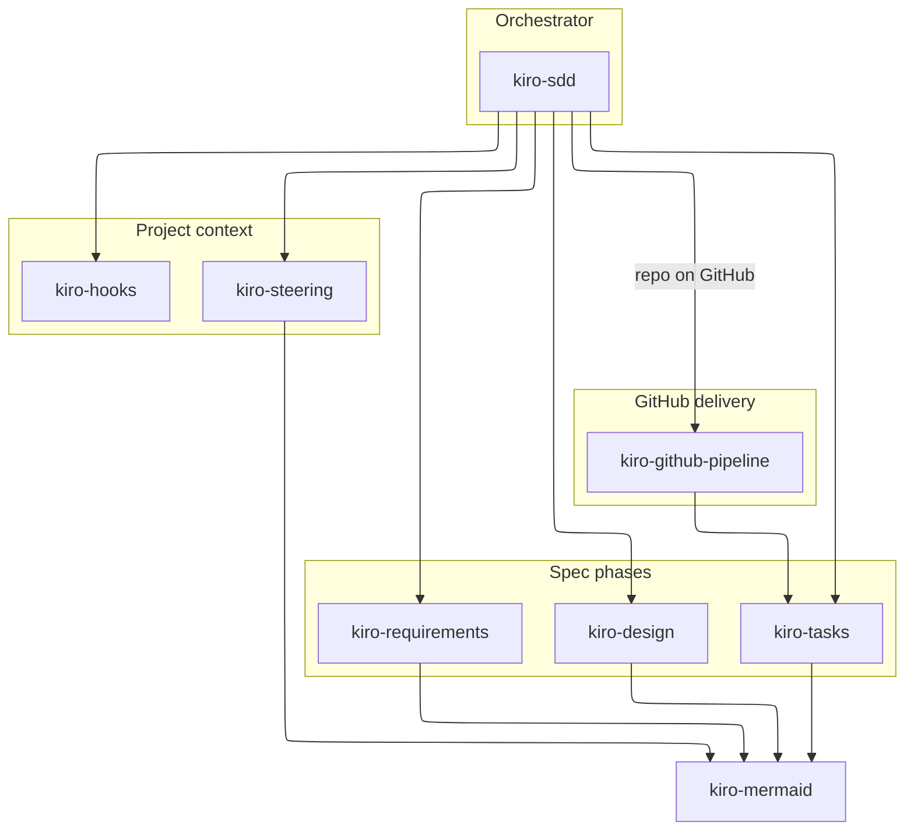
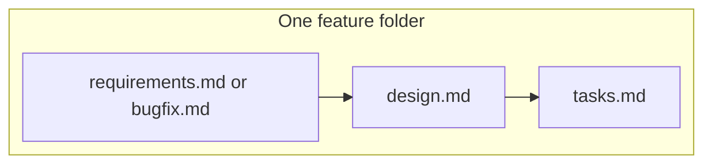

# Kiro SDD skills

Agent skills that write [Kiro](https://kiro.dev/docs/specs/) spec-driven development artifacts: feature and bugfix specs, steering files, and agent hooks. The documents they produce use [Mermaid](https://mermaid.js.org/) diagrams in fenced blocks so GitHub can render them.

The skills follow the [Agent Skills](https://agentskills.io/specification) layout. Each skill is a folder with a `SKILL.md` file. The front matter has `name` and `description`. Templates live in `assets/`, and longer notes live in `references/`.



## Skills

| Skill | Use it when |
| --- | --- |
| `kiro-sdd` | You want the whole flow: pick Requirements-First, Design-First, Quick Spec, or Bugfix, stop at the spec approval gates, then execute every approved task continuously |
| `kiro-requirements` | You are writing `requirements.md` or `bugfix.md` with user stories and EARS criteria |
| `kiro-design` | You are writing `design.md`, or an architecture note or ADR the spec cites |
| `kiro-tasks` | You are writing `tasks.md`, including the dependency DAG. Task 1 always sets up CI |
| `kiro-steering` | You are writing `.kiro/steering/` files and inclusion modes |
| `kiro-hooks` | You are writing `.kiro/hooks/*.json` hooks |
| `kiro-mermaid` | You are adding diagrams or checking that they render |
| `kiro-github-pipeline` | The repo is on GitHub: the idea and any open questions live in the issue, spec and steering docs are committed straight to the default branch and approved by the user, approved tasks run continuously with one conventional commit per task, tasks stay in sync with the issue, and one implementation PR closes the issue. PRs are only for implementation. Uses `git` and `gh` only |

Copy every folder you want. `kiro-sdd` points at the others, so install the set together.

## What the skills write



```text
.kiro/specs/<feature-name>/
  requirements.md    # or bugfix.md
  design.md
  tasks.md
.kiro/steering/
  product.md
  tech.md
  structure.md
.kiro/hooks/
  lint-on-save.json
docs/
  architecture.md
  adr/0001-decision.md
.github/
  workflows/ci.yml   # task 1 of every task plan
```

Feature requirements use numbered user stories and EARS lines (`WHEN ... THEN the system SHALL ...`). Tasks are checkboxes, and task 1 creates or updates the CI workflow. A task that does work ends with `_Requirements: 1.2, 3.1_`. `tasks.md` also contains a Mermaid DAG: phases as subgraphs, parallel groups nested inside them, arrows for depends-on, and `classDef` styles for the critical path, parallel work, and blocked work.

Specs are sized to the change: grouped criteria, tables over prose, each fact stated once, no ceremony checklists, and as many diagrams as the structure needs. The agent makes routine calls itself and records them as Decisions in `design.md`. It asks at most one or two questions, only where a wrong guess would be costly, and on GitHub those go on the issue.

Requirements, design, and tasks keep their human approval gates. On GitHub, each spec file is pushed straight to the default branch before its gate, with a short summary of what is being built, the decisions, and the risks. After approval, implementation runs every required task test-first in DAG order without routine stops and updates `tasks.md` and the GitHub issue together. It gets one code review of the whole branch, then opens one implementation PR with Summary, Changes, and Testing. One-task-at-a-time step mode is used only when the user explicitly requests it. The agent pauses only for a material ambiguity or spec change, a destructive or out-of-scope action, missing access, three failed fix attempts on the same task, or a human-only step.

Steering front matter supports `always`, `fileMatch` with `fileMatchPattern`, `manual`, and `auto`. Hooks use schema `v1` and PascalCase triggers such as `PostFileSave` and `UserPromptSubmit`. [`skills/kiro-hooks/assets/kiro-hooks.v1.schema.json`](skills/kiro-hooks/assets/kiro-hooks.v1.schema.json) is a JSON Schema for hook files, written from Kiro's field reference because Kiro does not publish one.

## Superpowers

Some steps are done better by [obra/superpowers](https://github.com/obra/superpowers) skills, so the kiro skills call those skills there instead of carrying their own version:

| Step | Superpowers skill | Called from |
| --- | --- | --- |
| The idea is too fuzzy to draft | `brainstorming` | `kiro-sdd`, `kiro-requirements` |
| Bugfix root cause; a failing test, build, or CI run | `systematic-debugging` | `kiro-sdd`, `kiro-design`, `kiro-github-pipeline` |
| Each task that changes behavior | `test-driven-development` | `kiro-sdd`, `kiro-tasks`, `kiro-github-pipeline` |
| After the last task, before the implementation PR | `requesting-code-review` | `kiro-sdd`, `kiro-github-pipeline` |
| Review findings or PR comments | `receiving-code-review` | `kiro-sdd`, `kiro-github-pipeline` |
| The checkout holds other work when implementation starts | `using-git-worktrees` | `kiro-github-pipeline` |

Requirements, design, tasks, the execution loop, verification, and finishing the branch stay with the kiro skills, because their formats and rules fit Kiro specs better. `writing-plans`, `executing-plans`, `subagent-driven-development`, `dispatching-parallel-agents`, `finishing-a-development-branch`, and `verification-before-completion` are not called on a Kiro spec. [`skills/kiro-sdd/references/superpowers.md`](skills/kiro-sdd/references/superpowers.md) has the scored comparison for each step, the kiro rules that still apply inside each delegated skill, and the fallbacks.

Before calling one, the agent checks that it is installed, and installs it if it is missing:

```bash
sh skills/kiro-sdd/scripts/ensure-superpowers.sh test-driven-development systematic-debugging
# installs anything missing with:
#   npx -y skills add obra/superpowers -g -y --skill <skill> ...
# prints "<skill> <path to SKILL.md>", or "<skill> MISSING" and exit 1
```

The script looks for `<skill>/SKILL.md` in project and global `.agents`, `.claude`, `.kiro`, and `.cursor` skill folders, in `~/.codex/skills`, and in the Claude Code plugin cache. A skill that is already there is never reinstalled. If the install cannot run (no Node.js, no network, or policy), the agent says so and follows the kiro fallback for that step. To try the install without touching your real setup:

```bash
HOME=$(mktemp -d) CI=true sh skills/kiro-sdd/scripts/ensure-superpowers.sh test-driven-development
```

## Example

A complete specimen is in [`examples/reading-queue`](examples/reading-queue/README.md): a personal reading queue, plus a small bugfix spec for duplicate titles.

## Install

### With the `skills` CLI

Install with the [`skills` CLI](https://github.com/vercel-labs/skills) (Node.js 22.20 or later). It records the source, so `npx skills update` keeps the skills current:

```bash
# All skills in this repo, globally (kiro-sdd links to the others, so install the set together)
npx skills add sohampatwardhan/kiro-sdd-skills -g

# One skill, for chosen agents only
npx skills add sohampatwardhan/kiro-sdd-skills -g --skill kiro-mermaid -a claude-code -a codex

# Update later
npx skills update -g
```

### By hand

Copy each skill directory into the location your agent reads. The folder name must stay the same, because `name` in the front matter has to match it.

| Agent | Project | Global |
| --- | --- | --- |
| Kiro | `.kiro/skills/` | `~/.kiro/skills/` |
| Claude Code | `.claude/skills/` | `~/.claude/skills/` |
| Cursor | `.cursor/skills/` or `.agents/skills/` | `~/.cursor/skills/` |
| Codex, Copilot, Gemini CLI, and other agents that share the Agent Skills directory | `.agents/skills/` | the global skills path that agent documents |

```bash
# Example: this repo's skills into a Kiro workspace
mkdir -p .kiro/skills
cp -R skills/kiro-sdd skills/kiro-requirements skills/kiro-design \
      skills/kiro-tasks skills/kiro-steering skills/kiro-hooks \
      skills/kiro-mermaid skills/kiro-github-pipeline .kiro/skills/
```

Kiro's default agent loads `.kiro/skills/` and `~/.kiro/skills/` on its own. A custom Kiro agent needs the skills in its resources:

```json
{ "resources": ["skill://.kiro/skills/**/SKILL.md"] }
```

Kiro can also import one skill from a GitHub URL that points at that skill's folder, not at the repository root. The `skills` CLI above installs the same folders for other agents. Skill names here are the folder names, such as `kiro-sdd`.

Workspace skills override global skills of the same name.

## Check the diagrams

[`skills/kiro-mermaid/scripts/validate-mermaid.mjs`](skills/kiro-mermaid/scripts/validate-mermaid.mjs) extracts every `mermaid` fence and renders it with [`@mermaid-js/mermaid-cli`](https://github.com/mermaid-js/mermaid-cli) (`mmdc`). It does not rewrite the Markdown.

```bash
node skills/kiro-mermaid/scripts/validate-mermaid.mjs
```

Set `CHROME_PATH` if Chrome or Chromium is not on `PATH`. The script needs Node.js and a browser because `mmdc` validates by rendering.

## Check the hooks

[`skills/kiro-hooks/scripts/validate-hooks.mjs`](skills/kiro-hooks/scripts/validate-hooks.mjs) validates hook files against the JSON Schema with [Ajv](https://ajv.js.org/). It also reports duplicate hook names and file-trigger matchers that are not valid regular expressions.

```bash
npm install --no-save ajv
node skills/kiro-hooks/scripts/validate-hooks.mjs examples/reading-queue/.kiro/hooks
```

## Format notes

Context7 was over its monthly request quota in this environment, so the formats were checked against the published docs on 2026-10-29 rather than through Context7.

Confirmed from those docs:

- Specs: [kiro.dev/docs/specs](https://kiro.dev/docs/specs/), [feature specs](https://kiro.dev/docs/specs/feature-specs/), [bugfix specs](https://kiro.dev/docs/specs/bugfix-specs/), [best practices](https://kiro.dev/docs/specs/best-practices/)
- Steering: [kiro.dev/docs/steering](https://kiro.dev/docs/steering/)
- Hooks: [kiro.dev/docs/hooks](https://kiro.dev/docs/hooks/), [trigger types](https://kiro.dev/docs/hooks/types/), [IDE 1.0 migration](https://kiro.dev/docs/ide/whats-new-v1/hooks/). The bundled JSON Schema is derived from those pages. It is not an official Kiro file.
- GitHub CLI: [cli.github.com/manual](https://cli.github.com/manual/) for `gh issue create`, `gh issue edit` (including `--parent` and `--add-sub-issue`), `gh issue comment`, `gh pr create`, `gh pr view`, `gh pr checks`, and `gh run list`, checked through Context7 on 2026-11-02. Action majors in the CI skeleton (`actions/checkout@v6`, `actions/setup-node@v6`) were checked the same day.
- Skills: [kiro.dev/docs/skills](https://kiro.dev/docs/skills/) and [agentskills.io/specification](https://agentskills.io/specification)
- Diagrams: [Mermaid flowchart](https://mermaid.js.org/syntax/flowchart.html), [state](https://mermaid.js.org/syntax/stateDiagram.html), [layouts](https://mermaid.js.org/config/layouts.html), [sequence](https://mermaid.js.org/syntax/sequenceDiagram.html), [class](https://mermaid.js.org/syntax/classDiagram.html), [ER](https://mermaid.js.org/syntax/entityRelationshipDiagram.html), and mermaid-cli. Every flowchart and state diagram sets `config.layout` to `elk` in YAML front matter. Other diagram types do not. Layout was checked against the layouts page on 2026-10-31.

A few details are called out in the skills because the public pages do not settle them. The task DAG is documentation these skills add. Kiro infers dependencies when it runs tasks. It does not parse the diagram. New hooks are `.kiro/hooks/*.json`, not `.kiro.hook`.

## License

[MIT](LICENSE)
