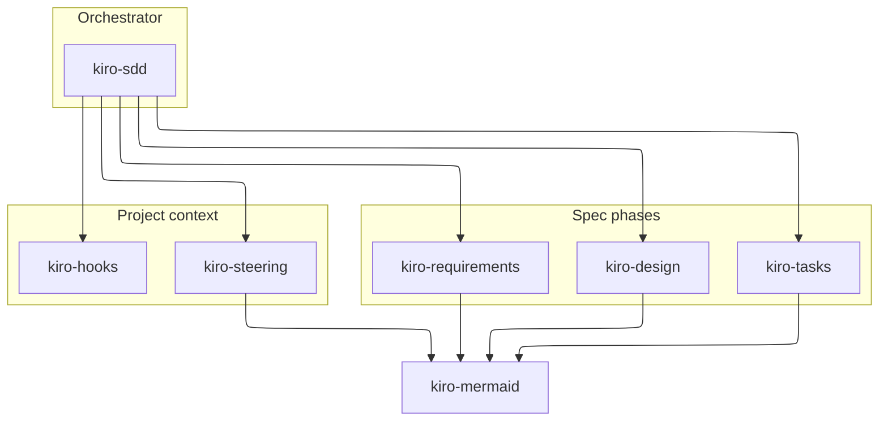
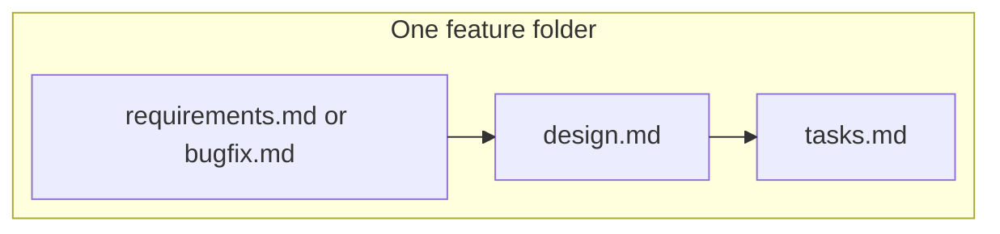

# Kiro SDD skills

Agent skills that write [Kiro](https://kiro.dev/docs/specs/) spec-driven development artifacts: feature and bugfix specs, steering files, and agent hooks. The documents they produce use [Mermaid](https://mermaid.js.org/) diagrams in fenced blocks so GitHub can render them.

The skills follow the [Agent Skills](https://agentskills.io/specification) layout. Each skill is a folder with a `SKILL.md` file. The front matter has `name` and `description`. Templates live in `assets/`, and longer notes live in `references/`.



## Skills

| Skill | Use it when |
| --- | --- |
| `kiro-sdd` | You want the whole flow: pick Requirements-First, Design-First, Quick Spec, or Bugfix, and stop at the approval gates |
| `kiro-requirements` | You are writing `requirements.md` or `bugfix.md` with user stories and EARS criteria |
| `kiro-design` | You are writing `design.md`, or an architecture note or ADR the spec cites |
| `kiro-tasks` | You are writing `tasks.md`, including the dependency DAG |
| `kiro-steering` | You are writing `.kiro/steering/` files and inclusion modes |
| `kiro-hooks` | You are writing `.kiro/hooks/*.json` hooks |
| `kiro-mermaid` | You are adding diagrams or checking that they render |

Copy every folder you want. `kiro-sdd` points at the others, so install the set together.

## What the skills write



```text
.kiro/specs/<feature-name>/
  requirements.md    # or bugfix.md
  design.md
  tasks.md
.kiro/steering/
  product.md
  tech.md
  structure.md
.kiro/hooks/
  lint-on-save.json
docs/
  architecture.md
  adr/0001-decision.md
```

Feature requirements use numbered user stories and EARS lines (`WHEN ... THEN the system SHALL ...`). Tasks are checkboxes. A task that does work ends with `_Requirements: 1.2, 3.1_`. `tasks.md` also contains a Mermaid DAG: phases as subgraphs, parallel groups nested inside them, arrows for depends-on, and `classDef` styles for the critical path, parallel work, and blocked work.

Steering front matter supports `always`, `fileMatch` with `fileMatchPattern`, `manual`, and `auto`. Hooks use schema `v1` and PascalCase triggers such as `PostFileSave` and `UserPromptSubmit`. [`skills/kiro-hooks/assets/kiro-hooks.v1.schema.json`](skills/kiro-hooks/assets/kiro-hooks.v1.schema.json) is a JSON Schema for hook files, written from Kiro's field reference because Kiro does not publish one.

A complete specimen is in [`examples/reading-queue`](examples/reading-queue/README.md): a personal reading queue, plus a small bugfix spec for duplicate titles.

## Install

Copy each skill directory into the location your agent reads. The folder name must stay the same, because `name` in the front matter has to match it.

| Agent | Project | Global |
| --- | --- | --- |
| Kiro | `.kiro/skills/` | `~/.kiro/skills/` |
| Claude Code | `.claude/skills/` | `~/.claude/skills/` |
| Cursor | `.cursor/skills/` or `.agents/skills/` | `~/.cursor/skills/` |
| Codex, Copilot, Gemini CLI, and other agents that share the Agent Skills directory | `.agents/skills/` | the global skills path that agent documents |

```bash
# Example: this repo's skills into a Kiro workspace
mkdir -p .kiro/skills
cp -R skills/kiro-sdd skills/kiro-requirements skills/kiro-design \
      skills/kiro-tasks skills/kiro-steering skills/kiro-hooks \
      skills/kiro-mermaid .kiro/skills/
```

Kiro's default agent loads `.kiro/skills/` and `~/.kiro/skills/` on its own. A custom Kiro agent needs the skills in its resources:

```json
{ "resources": ["skill://.kiro/skills/**/SKILL.md"] }
```

Kiro can also import one skill from a GitHub URL that points at that skill's folder, not at the repository root. The `skills` CLI can install the same folders for other agents (`npx skills add <repo> -a <agent>`). Skill names here are the folder names, such as `kiro-sdd`.

Workspace skills override global skills of the same name.

## Check the diagrams

[`skills/kiro-mermaid/scripts/validate-mermaid.mjs`](skills/kiro-mermaid/scripts/validate-mermaid.mjs) extracts every `mermaid` fence and renders it with [`@mermaid-js/mermaid-cli`](https://github.com/mermaid-js/mermaid-cli) (`mmdc`). It does not rewrite the Markdown.

```bash
node skills/kiro-mermaid/scripts/validate-mermaid.mjs
```

Set `CHROME_PATH` if Chrome or Chromium is not on `PATH`. The script needs Node.js and a browser because `mmdc` validates by rendering.

## Check the hooks

[`skills/kiro-hooks/scripts/validate-hooks.mjs`](skills/kiro-hooks/scripts/validate-hooks.mjs) validates hook files against the JSON Schema with [Ajv](https://ajv.js.org/). It also reports duplicate hook names and file-trigger matchers that are not valid regular expressions.

```bash
npm install --no-save ajv
node skills/kiro-hooks/scripts/validate-hooks.mjs examples/reading-queue/.kiro/hooks
```

## Format notes

Context7 was over its monthly request quota in this environment, so the formats were checked against the published docs on 2026-10-29 rather than through Context7.

Confirmed from those docs:

- Specs: [kiro.dev/docs/specs](https://kiro.dev/docs/specs/), [feature specs](https://kiro.dev/docs/specs/feature-specs/), [bugfix specs](https://kiro.dev/docs/specs/bugfix-specs/), [best practices](https://kiro.dev/docs/specs/best-practices/)
- Steering: [kiro.dev/docs/steering](https://kiro.dev/docs/steering/)
- Hooks: [kiro.dev/docs/hooks](https://kiro.dev/docs/hooks/), [trigger types](https://kiro.dev/docs/hooks/types/), [IDE 1.0 migration](https://kiro.dev/docs/ide/whats-new-v1/hooks/). The bundled JSON Schema is derived from those pages. It is not an official Kiro file.
- Skills: [kiro.dev/docs/skills](https://kiro.dev/docs/skills/) and [agentskills.io/specification](https://agentskills.io/specification)
- Diagrams: [Mermaid flowchart](https://mermaid.js.org/syntax/flowchart.html), [state](https://mermaid.js.org/syntax/stateDiagram.html), [layouts](https://mermaid.js.org/config/layouts.html), [sequence](https://mermaid.js.org/syntax/sequenceDiagram.html), [class](https://mermaid.js.org/syntax/classDiagram.html), [ER](https://mermaid.js.org/syntax/entityRelationshipDiagram.html), and mermaid-cli. Every flowchart and state diagram sets `config.layout` to `elk` in YAML front matter. Other diagram types do not. Layout was checked against the layouts page on 2026-10-31.

A few details are called out in the skills because the public pages do not settle them. The task DAG is documentation these skills add. Kiro infers dependencies when it runs tasks. It does not parse the diagram. New hooks are `.kiro/hooks/*.json`, not `.kiro.hook`.

## License

[MIT](LICENSE)
