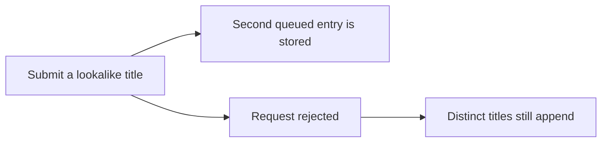
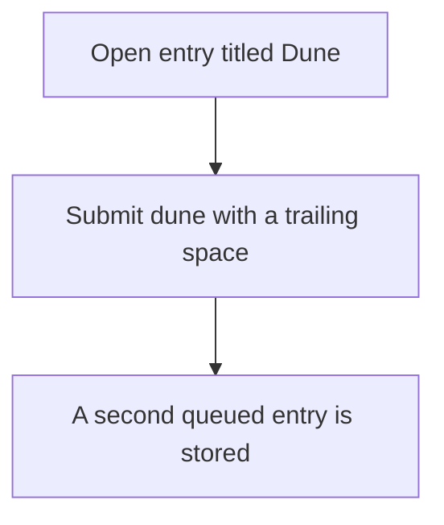
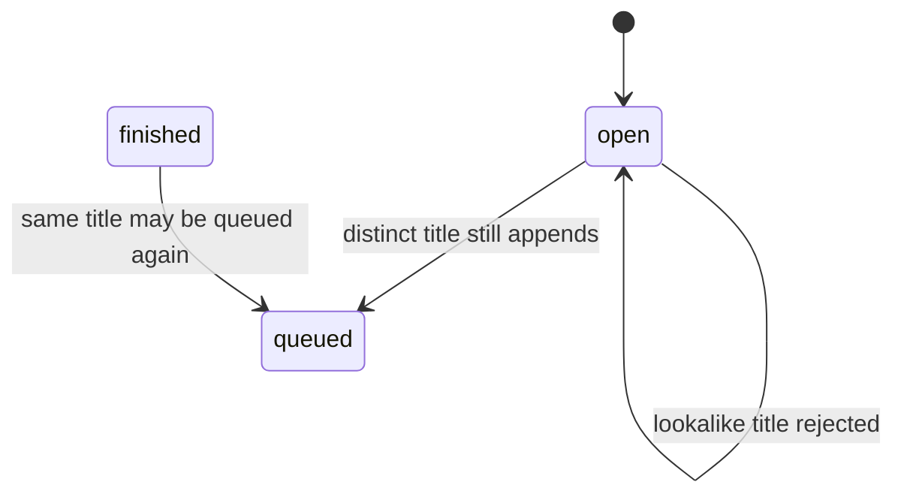

# Bugfix Document

## Introduction

Appending a book compares the raw title. `Dune` and `dune ` both become open entries for the same member. The fix is to compare titles after trim and case fold. Author matching, reorder, and the one-active-book rule stay as they are. No new queue status is introduced.

## Current Behavior

### Requirement 1

**User Story:** As a member, I want the duplicate defect recorded, so that a test can prove the bug existed.

#### Acceptance Criteria

1. WHEN a member submits a title that matches an open entry except for case or surrounding whitespace THEN the system stores a second queued entry

## Expected Behavior

### Requirement 2

**User Story:** As a member, I want lookalike titles treated as the same open book, so that my queue does not fill with copies.

#### Acceptance Criteria

1. WHEN a member submits a title that matches an open entry after trim and case fold THEN the system SHALL reject the request and leave the queue unchanged

## Unchanged Behavior

### Requirement 3

**User Story:** As a member, I want genuine new titles and finished books to behave as before, so that the fix stays limited to open duplicates.

#### Acceptance Criteria

1. WHEN a member submits a title that does not match any open entry after trim and case fold THEN the system SHALL CONTINUE TO append a queued entry
2. WHEN a member submits a title that matches only a finished or abandoned entry THEN the system SHALL CONTINUE TO append a queued entry
3. WHEN a member reorders queued entries THEN the system SHALL CONTINUE TO persist that order without consulting title normalization

