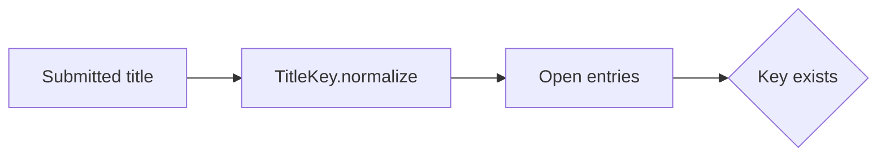
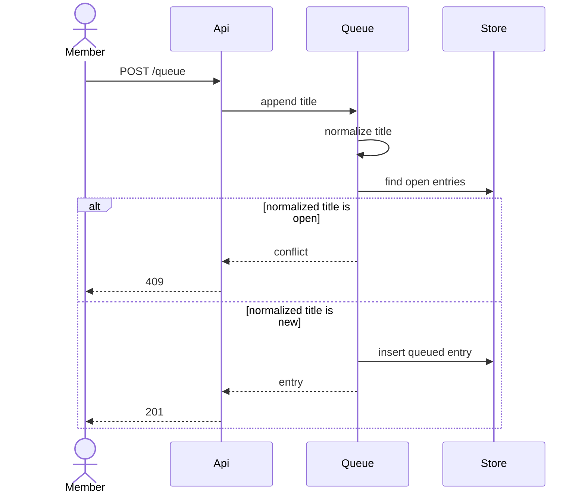
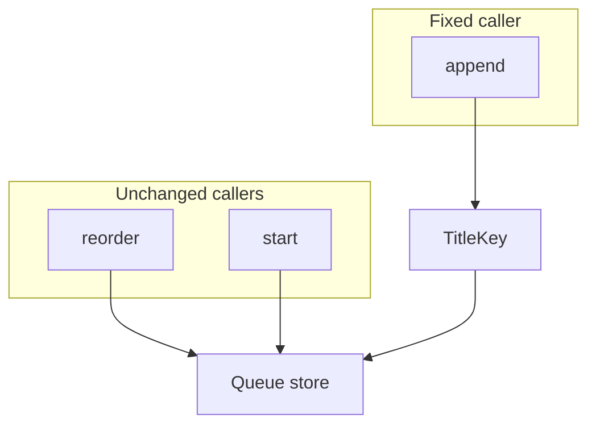
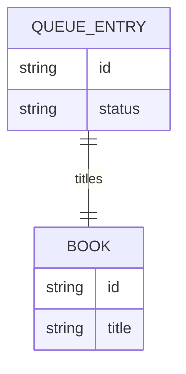
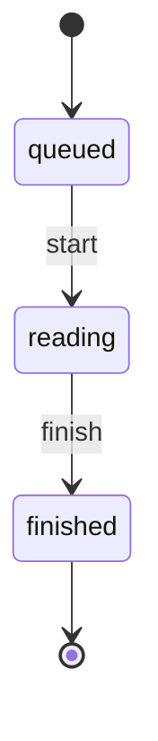
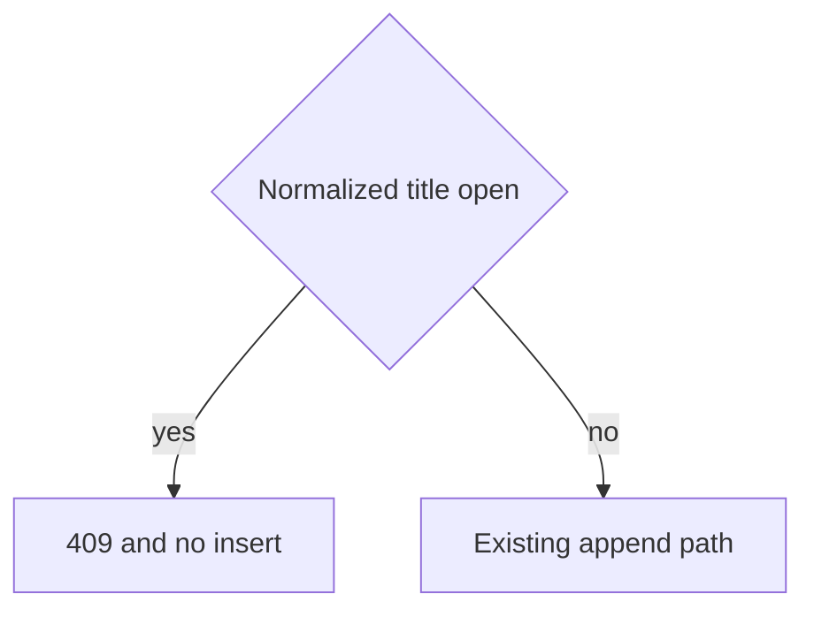
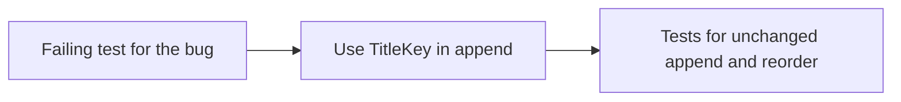

# Design Document

## Overview

Root cause: `QueueService.append` compares `book.title` to the submitted string with ordinary string equality. Whitespace and case bypass requirement 1.4 of the reading-queue spec. The repair is to compare `TitleKey.normalize` output for entries whose status is queued or reading. Finished and abandoned entries are not part of the comparison.

No schema change. No new route. The reading-queue design already names `TitleKey`. This bugfix only makes append use it.

## Architecture

The broken call writes a second row. The fixed call returns before `insert`.

Reorder never calls `TitleKey`. That keeps requirement 3.3 of this bugfix true.

## Components and Interfaces

### TitleKey

`normalize(title)` trims both ends and case-folds with the runtime default locale used by the rest of Shelf Club. It does not strip punctuation. `Dune` and `Dune!` stay distinct.

### QueueService.append

Load the member's queued and reading entries. If any stored title normalizes to the same key as the submitted title, return a conflict and do not call `insert`. Otherwise keep the existing append path, including the empty-title rejection, which still happens before the duplicate check.

## Data Models

No new entity and no new status. The comparison set is a filter on `QUEUE_ENTRY.status`.

Finished and abandoned rows stay out of the duplicate set, so the same title may be queued again later.

## Error Handling

| Condition | Result | State |
| --- | --- | --- |
| Normalized title matches a queued or reading entry | 409 conflict | unchanged |
| Store read fails | 503 | unchanged |
| Title is new after normalize | existing 201 path | one new row |

## Testing Strategy

- Property: the current append, given `Dune` already queued and a submission of `dune `, inserts a second entry. Validates: Requirement 1.1. This test is expected to fail before the fix.
- Property: after the fix, the same input inserts nothing and returns conflict. Validates: Requirement 2.1.
- Property: a title that normalizes to something else still appends. Validates: Requirement 3.1.
- Property: a title that matches only a finished entry still appends. Validates: Requirement 3.2.
- Property: reorder of queued ids does not change because of normalization. Validates: Requirement 3.3.

