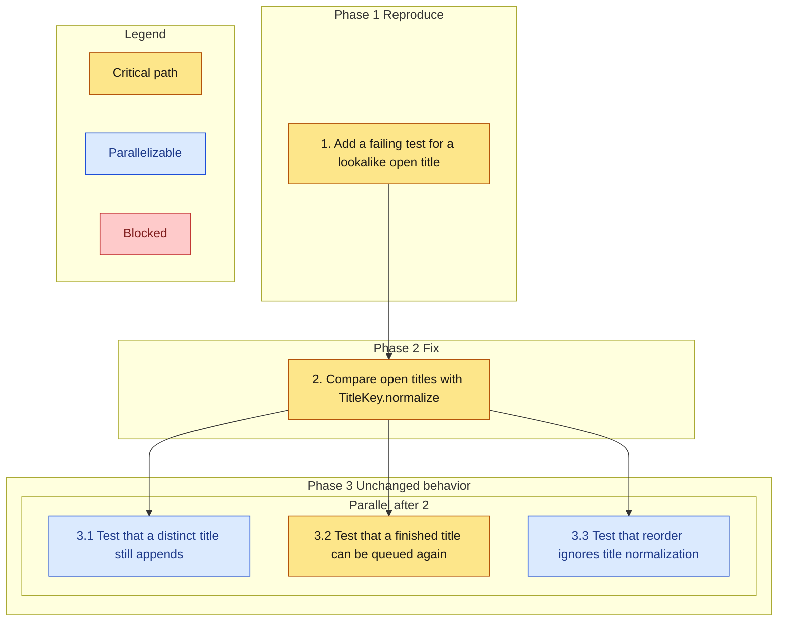

# Implementation Plan

- [ ] 1. Add a failing test for a lookalike open title
  - Queue `Dune`, then submit `dune ` and expect a second entry on the current code
  - _Requirements: 1.1_

- [ ] 2. Compare open titles with TitleKey.normalize
  - Reject when a queued or reading entry normalizes to the same key
  - Do not insert a row on that path
  - _Requirements: 2.1_

- [ ] 3. Lock the behavior that must stay
- [ ] 3.1 Test that a distinct title still appends
  - Include a title that differs only by punctuation
  - _Requirements: 3.1_
- [ ] 3.2 Test that a finished title can be queued again
  - Finish `Dune`, then append `Dune` again
  - _Requirements: 3.2_
- [ ] 3.3 Test that reorder ignores title normalization
  - Reorder two queued ids and expect the submitted order
  - _Requirements: 3.3_

## Task graph

An arrow means depends-on. Primary critical path: 1, 2, 3.2. Tasks 3.1 and 3.3 run in parallel with 3.2 after the fix.

