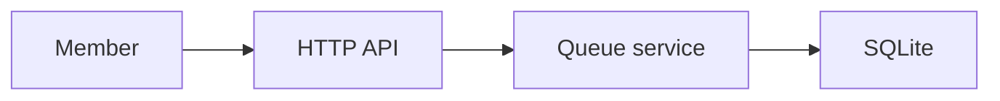
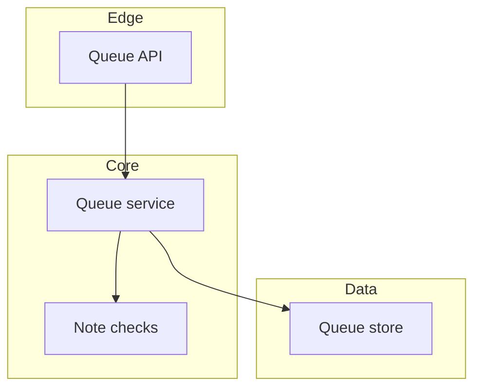
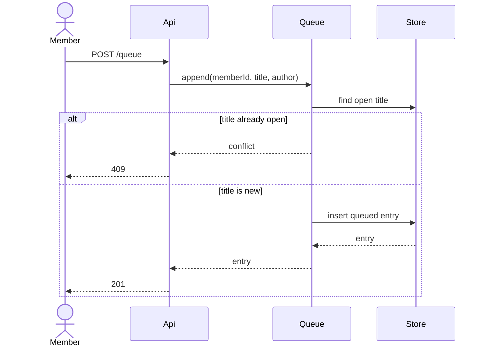
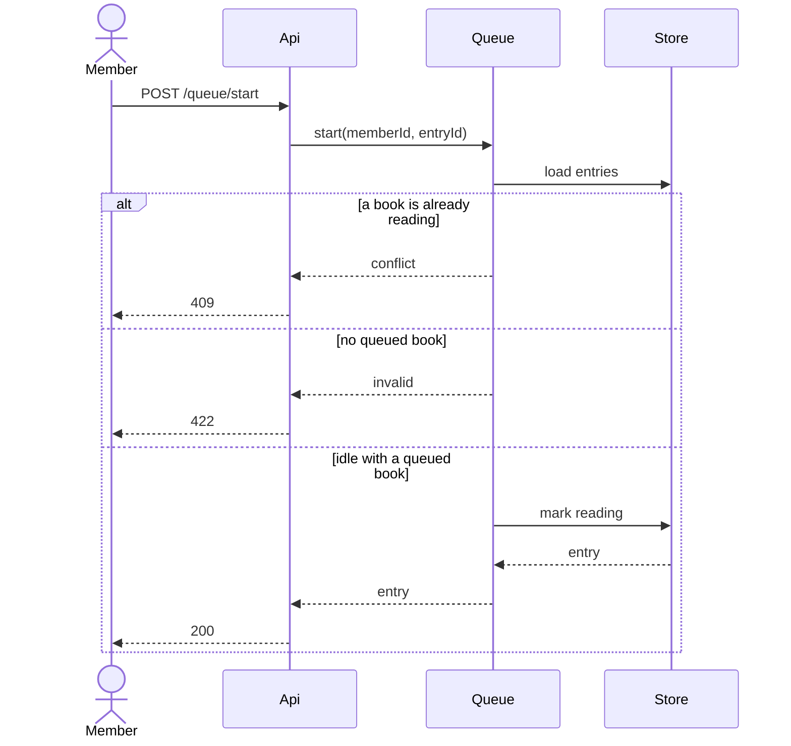
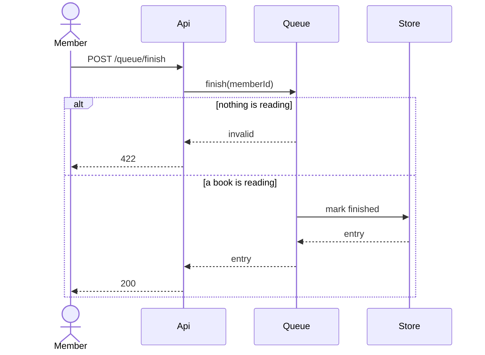
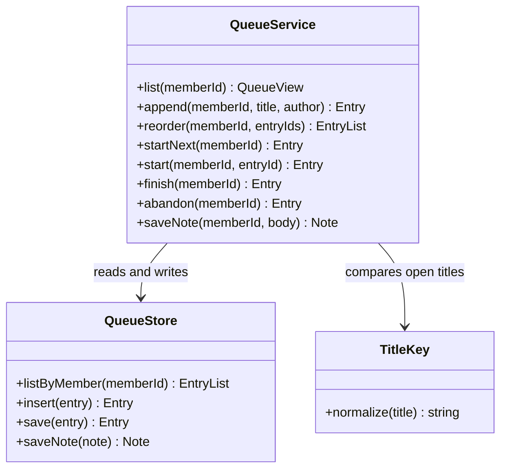
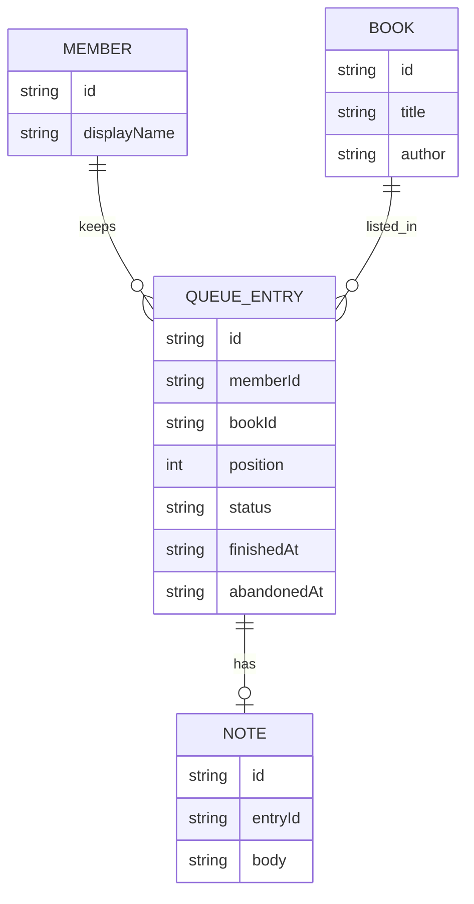
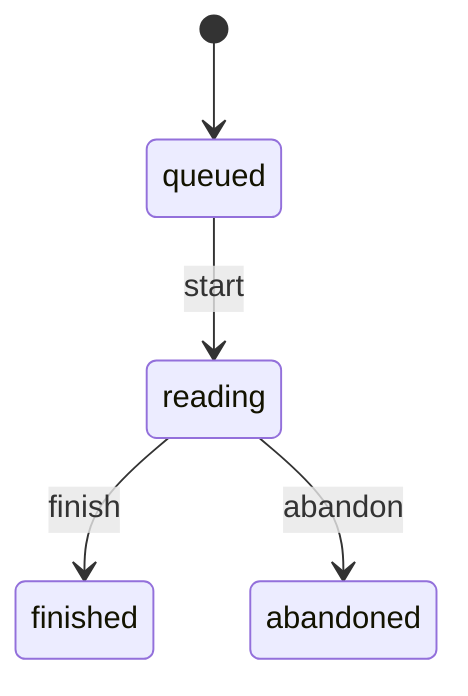
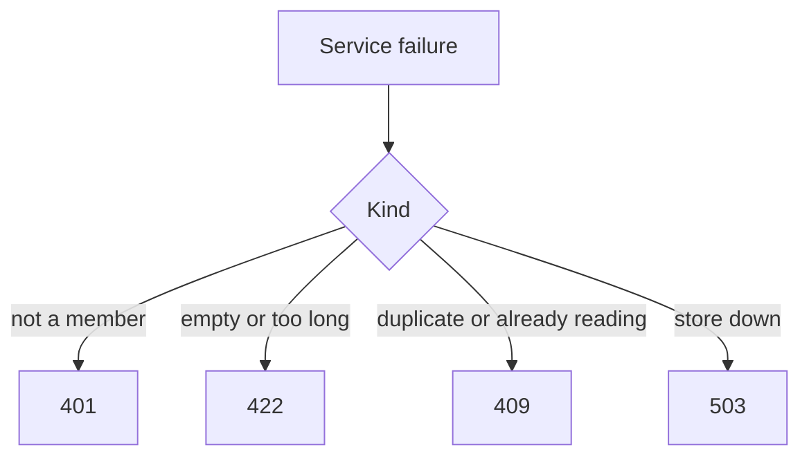
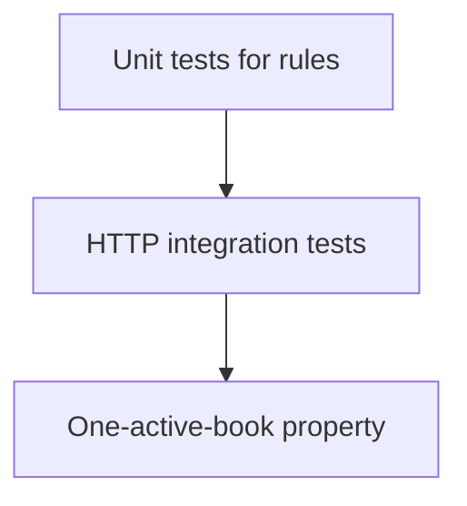

# Design Document

## Overview

The reading queue is a set of rules over four records: member, book, queue entry, and note. The HTTP API authenticates the member and maps errors to status codes. A queue service owns positions, the one-active-book rule, and note limits. SQLite stores the rows.

This follows [ADR 0001](../../../docs/adr/0001-one-active-book.md): at most one reading entry per member. The system shape is the [architecture overview](../../../docs/architecture.md). The stack matches `.kiro/steering/tech.md`.

The design covers requirements 1.1 through 6.3. Duplicate detection compares titles after trim and case fold, which is the behavior the duplicate-title bugfix spec also locks.

Rejected alternatives: storing the queue as a single JSON array on the member (reorder and status changes fight each other), and allowing multiple reading entries (forbidden by ADR 0001).

## Architecture

One process handles the request. The handler does not update rows itself.

Adding a book either appends an entry or returns a conflict. Nothing is written on the conflict path.

Starting a book moves one queued entry to reading, or rejects the call.

Finishing or abandoning clears the active book and does not change queued rows.

## Components and Interfaces

### Queue API

Accepts the member id from the session. Translates service errors into HTTP statuses from the API steering file. It does not reorder, compare titles, or decide which entry is active.

| Operation | Method and path | Success |
| --- | --- | --- |
| List | GET /queue | 200 and the ordered list |
| Append | POST /queue | 201 and the entry |
| Reorder | PATCH /queue/order | 200 and the queued entries |
| Start next | POST /queue/start | 200 and the reading entry |
| Start one | POST /queue/{id}/start | 200 and the reading entry |
| Finish | POST /queue/finish | 200 and the finished entry |
| Abandon | POST /queue/abandon | 200 and the abandoned entry |
| Save note | PUT /queue/note | 200 and the note |

### Queue service

Owns every rule in requirements 1 through 6. It refuses a second reading entry, compares titles after normalization, and will not attach a note unless an entry is reading.

`TitleKey.normalize` trims whitespace and case-folds. The store lookup for requirement 1.4 uses that key against entries whose status is queued or reading.

### Queue store

Reads and writes rows. It does not enforce the one-active-book rule. The service checks, then the store updates inside one transaction so a rejected request does not partially apply.

## Data Models

A book row is reused when the normalized title and author already exist. The open-title rule is per member, not global. Two members may queue the same title.

Illegal transitions, all rejected with no write:

- queued to finished, or queued to abandoned
- reading to queued
- finished or abandoned to any other state
- a second entry entering reading while one is already reading

Position is an integer among queued entries only. The reading entry is selected by status. Finished and abandoned entries sort by their completion timestamp descending, after the reading entry and the queued entries.

## Error Handling

| Condition | Criteria | HTTP | Stored state |
| --- | --- | --- | --- |
| Caller is not a member | 1.5, 6.3 | 401 | unchanged |
| Title empty after trim | 1.3 | 422 | unchanged |
| Open title already exists | 1.4 | 409 | unchanged |
| Reorder set is not exactly the queued ids | 2.2 | 422 | unchanged |
| Start when nothing is queued | 3.2 | 422 | unchanged |
| Start when a book is reading | 3.3 | 409 | unchanged |
| Finish or abandon when nothing is reading | 4.3 | 422 | unchanged |
| Note with nothing reading | 5.2 | 422 | unchanged |
| Note empty or over 4000 characters | 5.3, 5.4 | 422 | previous note kept |
| Store unavailable | none | 503 | unchanged |

The transaction rolls back on every path except a successful insert or status update. A finish writes the finished timestamp and the status together.

## Testing Strategy

Unit tests call `QueueService` with an in-memory store.

- Append, trim, empty title, duplicate title, and non-member: requirements 1.1 through 1.5.
- Reorder success, reorder rejection, and the reading entry staying reading: requirements 2.1 through 2.3.
- Start next, start one, empty queue, and already reading: requirements 3.1 through 3.4.
- Finish, abandon, nothing reading, and queued entries left queued: requirements 4.1 through 4.4.
- Note save, no active book, empty body, and overlong body: requirements 5.1 through 5.4.

Integration tests call the HTTP routes and assert the list order in requirements 6.1 and 6.2, including the empty list.

Property: for any member and any sequence of successful starts, the number of reading entries is 0 or 1. Validates: Requirement 3.3.

Property: a rejected call returns the same rows the store had before the call. Validates: Requirements 1.3, 1.4, 2.2, 3.3, 5.3.

