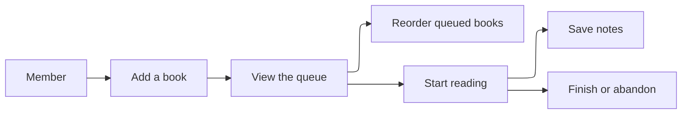
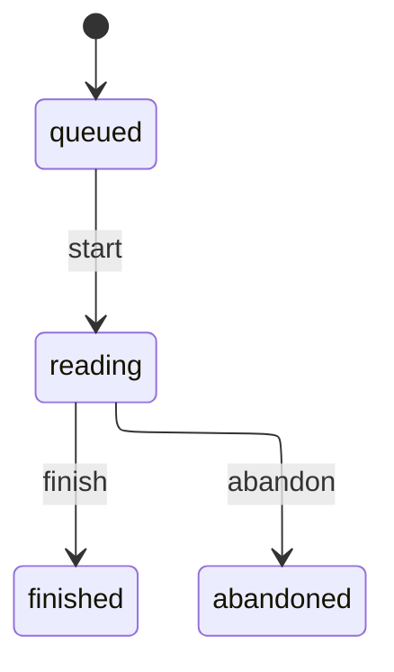
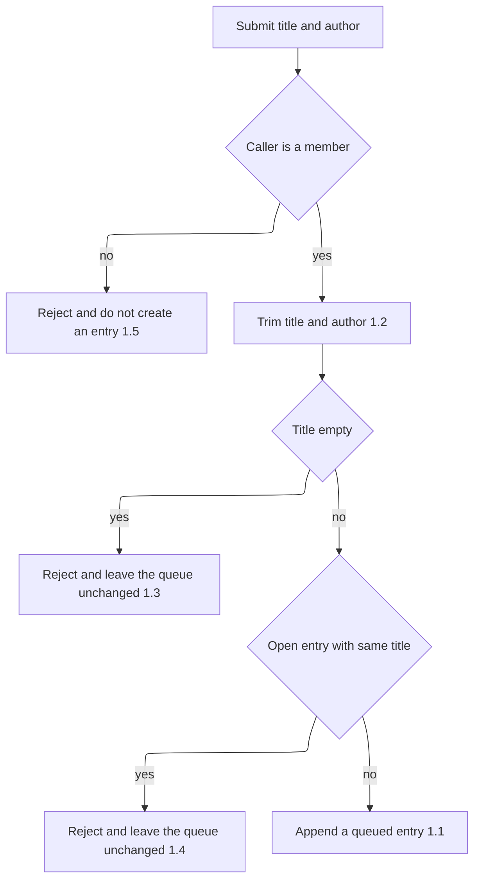

# Requirements Document

## Introduction

Shelf Club members keep a personal reading queue. A member adds books, reorders books they have not started, and reads one book at a time. Notes attach only to the book that is currently being read. This spec does not cover social sharing, recommendations, or importing a catalog from another service.

## Requirements

### Requirement 1

**User Story:** As a member, I want to add a book to the end of my queue, so that I can remember what to read next.

#### Acceptance Criteria

1. WHEN a member submits a title and author for a book that is not already open in their queue THEN the system SHALL append a queued entry at the next position
2. WHEN a member submits a title and author THEN the system SHALL store the title and author trimmed of surrounding whitespace
3. IF a member submits a title that is empty after trimming THEN the system SHALL reject the request and leave the queue unchanged
4. IF a member submits a title that matches an existing queued or reading entry for that member, ignoring case and surrounding whitespace THEN the system SHALL reject the request and leave the queue unchanged
5. IF the caller is not a member THEN the system SHALL reject the request and SHALL NOT create a queue entry

### Requirement 2

**User Story:** As a member, I want to reorder books I have not started, so that I can choose what to read next.

#### Acceptance Criteria

1. WHEN a member submits a new order for their queued entries THEN the system SHALL persist that order as the positions of those entries
2. IF the submitted order omits a queued entry or includes an entry that is not queued THEN the system SHALL reject the request and leave positions unchanged
3. WHEN a member reorders queued entries THEN the system SHALL leave the reading entry, if any, in the reading state

### Requirement 3

**User Story:** As a member, I want to start the next book only when I am not already reading one, so that I stay focused on a single book.

#### Acceptance Criteria

1. WHEN a member starts reading AND no entry is in the reading state AND the queue has a queued entry THEN the system SHALL move the lowest-position queued entry to reading
2. IF a member starts reading AND the queue has no queued entry THEN the system SHALL reject the request
3. IF a member starts reading AND an entry is already reading THEN the system SHALL reject the request and leave every entry unchanged
4. WHEN a member starts a specific queued entry AND no entry is reading THEN the system SHALL move that entry to reading and SHALL NOT move any other entry to reading

### Requirement 4

**User Story:** As a member, I want to finish or abandon the book I am reading, so that I can move on.

#### Acceptance Criteria

1. WHEN a member finishes the reading entry THEN the system SHALL mark that entry finished and record a finished timestamp
2. WHEN a member abandons the reading entry THEN the system SHALL mark that entry abandoned and record an abandoned timestamp
3. IF a member finishes or abandons AND no entry is reading THEN the system SHALL reject the request
4. WHEN a member finishes or abandons THEN the system SHALL leave queued entries queued

### Requirement 5

**User Story:** As a member, I want to keep notes on the book I am reading, so that I remember reactions while they are fresh.

#### Acceptance Criteria

1. WHEN a member saves a note AND an entry is reading THEN the system SHALL store the note body on that reading entry
2. IF a member saves a note AND no entry is reading THEN the system SHALL reject the request
3. IF a member saves a note whose body is empty after trimming THEN the system SHALL reject the request and leave any previous note unchanged
4. IF a member saves a note whose body is longer than 4000 characters THEN the system SHALL reject the request and leave any previous note unchanged

### Requirement 6

**User Story:** As a member, I want to see my queue in reading order, so that I know what is active and what is next.

#### Acceptance Criteria

1. WHEN a member requests their queue THEN the system SHALL return the reading entry first, then queued entries by ascending position, then finished and abandoned entries by completion time descending
2. WHEN a member requests their queue AND they have no entries THEN the system SHALL return an empty list
3. IF the caller is not a member THEN the system SHALL reject the request
