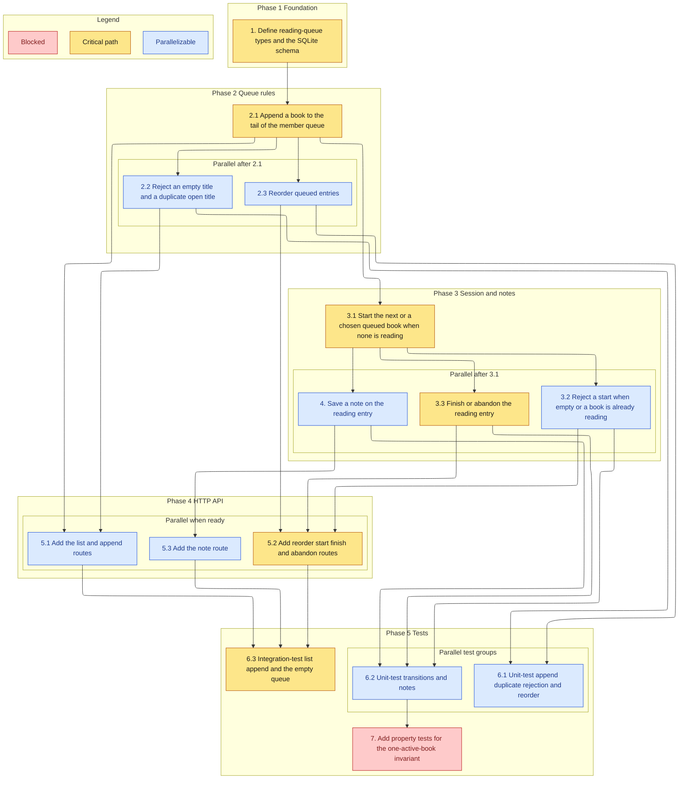

# Implementation Plan

- [ ] 1. Define reading-queue types and the SQLite schema
  - Add member, book, queue entry, note, and the status enum
  - Store position, status, and the finish and abandon timestamps on the entry
  - _Requirements: 1.2, 6.1_

- [ ] 2. Implement queue membership rules
- [ ] 2.1 Append a book to the tail of the member queue
  - Trim the title and author before save
  - Reject a caller who is not a member without inserting a row
  - _Requirements: 1.1, 1.2, 1.5_
- [ ] 2.2 Reject an empty title and a duplicate open title
  - Compare titles after trim and case fold against queued and reading entries
  - Leave stored rows unchanged when rejecting
  - _Requirements: 1.3, 1.4_
- [ ] 2.3 Reorder queued entries
  - Persist the submitted order when it is exactly the queued id set
  - Reject any other set and leave the reading entry reading
  - _Requirements: 2.1, 2.2, 2.3_

- [ ] 3. Implement reading transitions
- [ ] 3.1 Start the next queued book, or a chosen queued book, when none is reading
  - Move only the lowest-position queued entry when no id is given
  - Move only the requested queued entry when an id is given
  - _Requirements: 3.1, 3.4_
- [ ] 3.2 Reject a start when the queue is empty or a book is already reading
  - Return without writing
  - _Requirements: 3.2, 3.3_
- [ ] 3.3 Finish or abandon the reading entry
  - Record the matching timestamp and leave queued entries queued
  - Reject the call when nothing is reading
  - _Requirements: 4.1, 4.2, 4.3, 4.4_

- [ ] 4. Save a note on the reading entry
  - Store the body when a reading entry exists and the body is 1 to 4000 characters after trim
  - Reject an empty body, an overlong body, and a save when nothing is reading
  - _Requirements: 5.1, 5.2, 5.3, 5.4_

- [ ] 5. Expose the HTTP API
- [ ] 5.1 Add the list and append routes
  - Return the reading entry, then queued entries, then completed entries
  - Return an empty list when the member has no entries
  - _Requirements: 1.1, 1.5, 6.1, 6.2, 6.3_
- [ ] 5.2 Add the reorder, start, finish, and abandon routes
  - Map service conflicts and validation errors to the status codes in the design
  - _Requirements: 2.1, 3.1, 4.1_
- [ ] 5.3 Add the note route
  - Forward the body to the queue service and return the stored note
  - _Requirements: 5.1_

- [ ] 6. Test the queue rules and the API
- [ ] 6.1 Unit-test append, duplicate rejection, and reorder
  - Cover empty titles, case-insensitive duplicates, and a reorder that omits an id
  - _Requirements: 1.3, 1.4, 2.2, 2.3_
- [ ] 6.2 Unit-test transitions and notes
  - Cover an empty start, a second start, finish with nothing reading, and note limits
  - _Requirements: 3.2, 3.3, 4.3, 5.2, 5.3, 5.4_
- [ ] 6.3 Integration-test list, append, and the empty queue
  - Assert order and the unauthorized caller
  - _Requirements: 6.1, 6.2, 6.3_

- [ ] 7. Add property tests for the one-active-book invariant (optional)
  - Generate sequences of starts, finishes, and rejected calls
  - Assert a member never has two reading entries
  - _Requirements: 3.3_

## Task graph

An arrow means depends-on. The target stays unchecked until every source is checked. Primary critical path: 1, 2.1, 3.1, 3.3, 5.2, 6.3. That path delivers the reading transition through the API. Task 7 is optional, so a required run does not include it.

