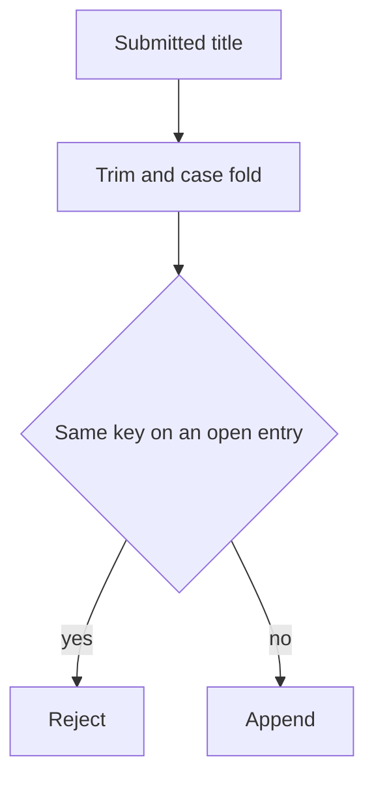

# Duplicate title notes

Load this file with `#duplicate-title-notes` when investigating a second copy of a book. It is not part of every session.

## What to compare

Compare titles only after trim and case fold, and only against queued and reading entries. A finished book may be queued again. Punctuation is not stripped.

