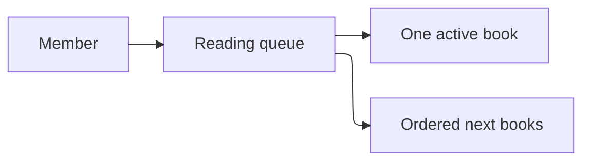

# Product

## Purpose

Shelf Club is a reading log for one person at a time. The reading queue remembers what they will read next and which single book is active.

## Users

Members who already have an account. This example does not add invitations, clubs, or public profiles.

## Objectives

- The member can trust "what am I reading" to have one answer.
- Rejected changes leave the queue as it was.
- Specs stay in `.kiro/specs/` and match this product boundary.

## In scope

- Add, reorder, start, finish, abandon, notes, and list

## Out of scope

- Recommendations, imports, and sharing a queue with another member
