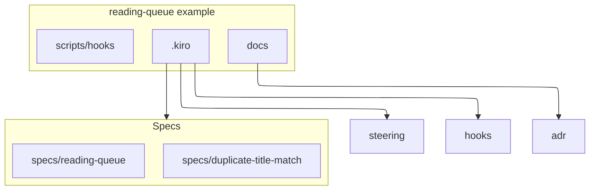

# Project structure

This example is a spec specimen. Application source is added only when someone executes the tasks. Until then the tree is documents.

## Where new files go

| Kind | Path |
| --- | --- |
| Feature spec | `.kiro/specs/<feature-name>/` |
| Steering | `.kiro/steering/` |
| Hooks | `.kiro/hooks/` |
| Architecture and ADRs | `docs/` and `docs/adr/` |
| Hook helper scripts | `scripts/hooks/` |

When the tasks are executed, queue types go in `src/queue/`, HTTP routes in `src/api/`, and tests in `test/`. Import the service from the API. Do not import the API from the service.

## Naming

- Spec folders are kebab-case.
- Steering files are kebab-case or the foundation names `product.md`, `tech.md`, and `structure.md`.
- ADR files are `NNNN-kebab-title.md`.
