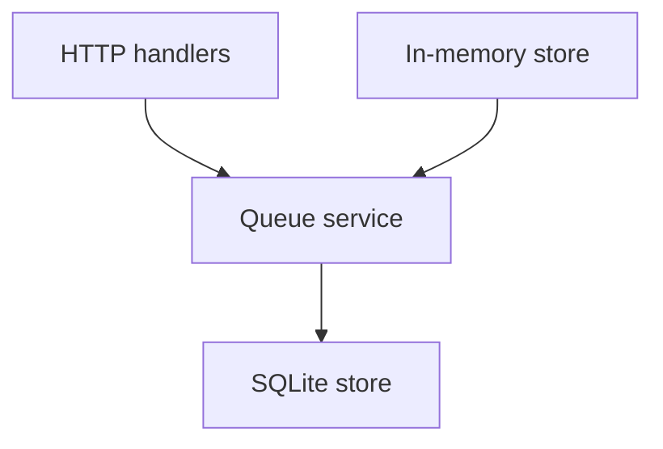

# Technology stack

## Runtime

TypeScript on Node.js. HTTP handlers are thin. Queue rules live in a service that does not import the HTTP framework.

## Data

SQLite through a small store interface. Tests use an in-memory implementation of that interface. There is no cache and no worker.

## Constraints

- Specs for this example follow the Kiro filenames under `.kiro/specs/`.
- A new feature uses the existing error statuses in `api-standards.md`.
- Do not add a second database.

The stable picture and the one-active-book decision:

#[[file:docs/architecture.md]]

#[[file:docs/adr/0001-one-active-book.md:1-16]]

