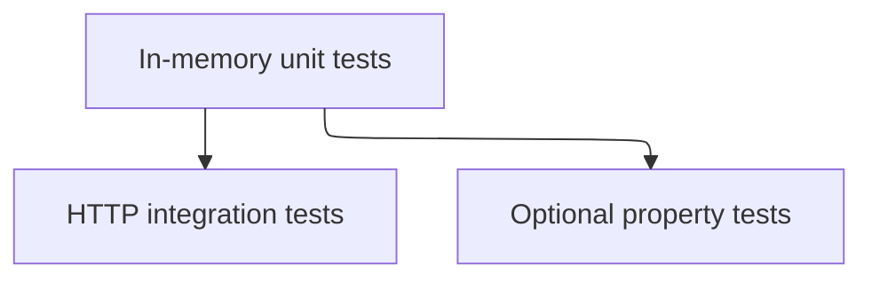

# Testing

## Layout

Unit tests construct `QueueService` with an in-memory store. Integration tests send HTTP to the queue routes. Property tests live next to the unit tests and are optional unless a bugfix task names them.

## What a change must prove

- A feature task's tests cover the requirement ids in its `_Requirements_` line.
- A bugfix includes a test that fails before the fix, a test that passes after, and a test that neighboring behavior did not move.

