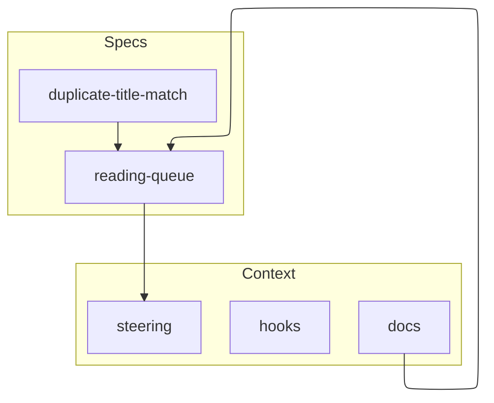

# Reading queue example

A Shelf Club reading queue, written as Kiro would store it. This folder is a specimen for the skills in this repository. It is not the spec for the skills themselves.

| Path | What it shows |
| --- | --- |
| `.kiro/specs/reading-queue/` | Requirements, design, and tasks for the feature, including the task DAG |
| `.kiro/specs/duplicate-title-match/` | A bugfix spec: `bugfix.md`, design, and tasks |
| `.kiro/steering/` | Foundation files plus `fileMatch`, `manual`, and `auto` examples |
| `.kiro/hooks/` | v1 JSON hooks |
| `docs/architecture.md` | Overview the design links to |
| `docs/adr/0001-one-active-book.md` | The decision to allow one reading entry |

The feature spec is Requirements-First. Updating it means editing the requirements, then the design, then the tasks, and keeping the DAG numbers aligned. The bugfix spec stays a bugfix. A larger change, such as shared queues, would be a new feature folder.
