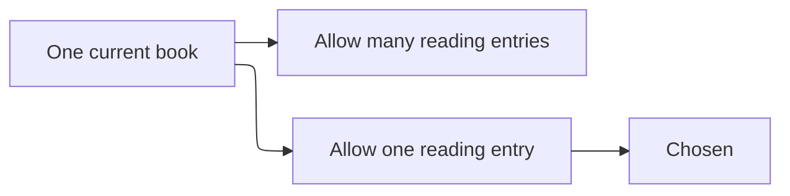

# ADR 0001: One active book

- Status: Accepted
- Date: 2026-10-29

## Context

Members asked for a queue they could reorder, and also for a clear answer to "what am I reading now". Allowing several reading entries makes notes, reorder, and the queue view ambiguous. Requirement 3.3 in the reading-queue spec forbids a second active book.

## Decision

A member has at most one queue entry in the reading state. Starting a book is rejected while another entry is reading. Finishing or abandoning is the only way to clear the active book. Queued entries stay queued across that transition.

The rule lives in the queue service, not in the HTTP handler, so every entry point shares it.

## Consequences

- The queue view can put the reading entry first without a tie break.
- Notes have a single legal target.
- A member cannot start a second book "just for a minute" without finishing or abandoning the first.
- Position is meaningful only for queued entries. The reading entry is found by status, not by position.

## Alternatives considered

| Alternative | Why it lost |
| --- | --- |
| Many books in reading | Notes and "what is next" become ambiguous |
| Pause instead of abandon | Adds a state the requirements do not ask for |
