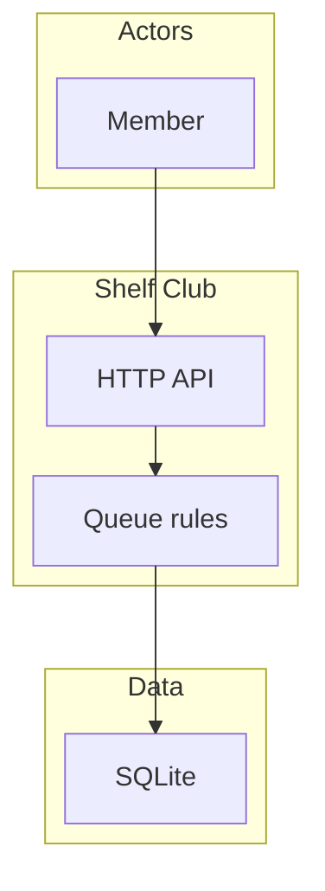
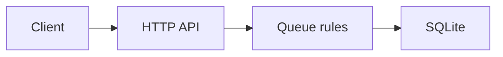

# Shelf Club architecture

Shelf Club is a single-user-per-request reading log. This example records the spec for a personal reading queue. The application code is not in this folder. The design in `.kiro/specs/reading-queue/design.md` is the source for that feature. This overview is the stable picture that feature design is not allowed to contradict.

## Containers

| Piece | Owns |
| --- | --- |
| HTTP API | Authentication of the member, status codes, request shape |
| Queue rules | Positions, one active book, note limits |
| SQLite | Members, books, queue entries, notes |

The API process is the only writer. There is no background worker in this version.

## Cross-cutting rules

- A request names one member, taken from the session. The body cannot choose a different member.
- Rejected requests leave stored rows unchanged.
- Errors use the status codes in `.kiro/steering/api-standards.md`.
