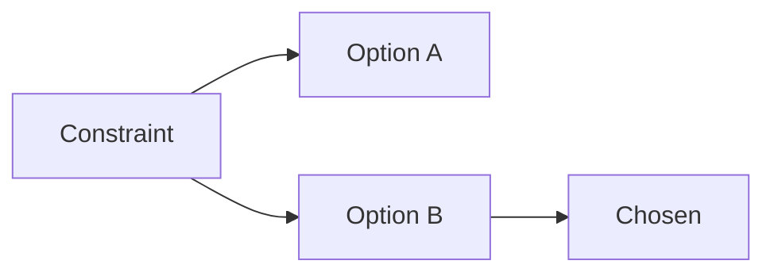

# ADR NNNN: [Decision title]

- Status: Proposed
- Date: YYYY-MM-DD

## Context

[What force makes this decision necessary. Link the spec or requirement ids.]

## Decision

[The decision, in a few sentences. What will be built.]

## Consequences

- [What becomes easier]
- [What becomes harder]
- [What remains unchanged]

## Alternatives considered

| Alternative | Why it lost |
| --- | --- |
| [Option A] | [reason] |
