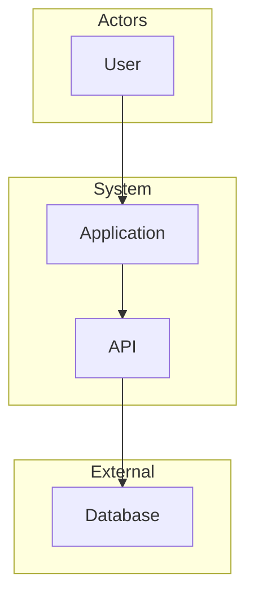
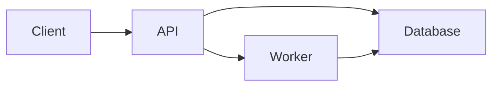

# Architecture overview

[One paragraph on what this system is and who it serves. This file is project context. Feature designs link here instead of repeating it.]

## Containers

[Short description of each runtime piece and what it owns.]

## Cross-cutting rules

- [How requests are authenticated]
- [How errors are shaped]
- [What this overview deliberately does not decide]
