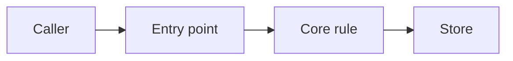
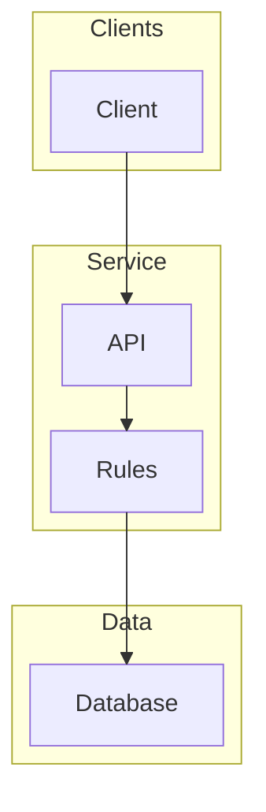
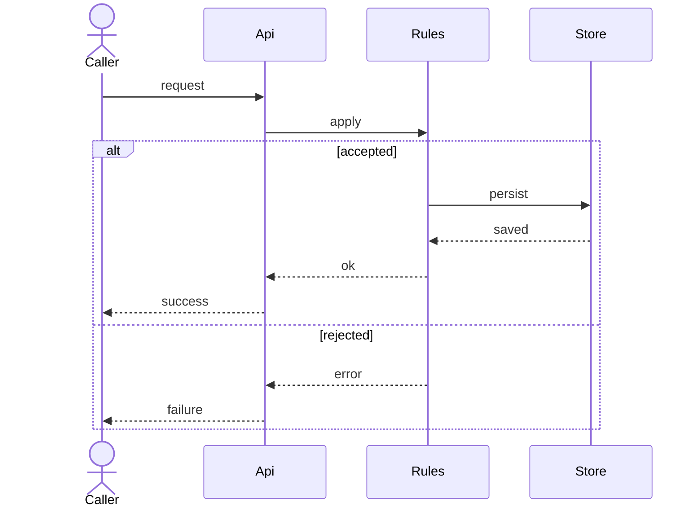
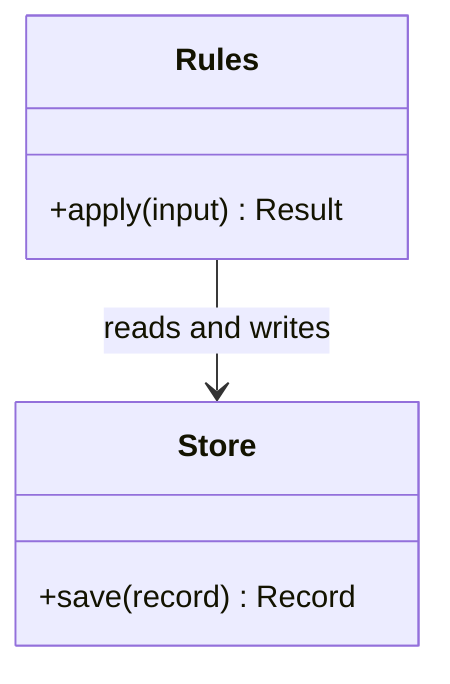
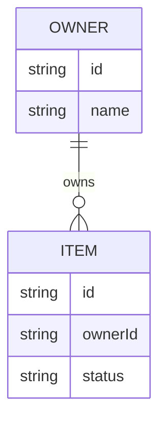
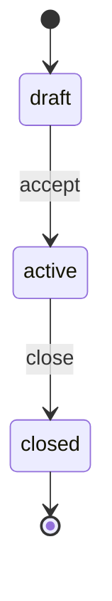
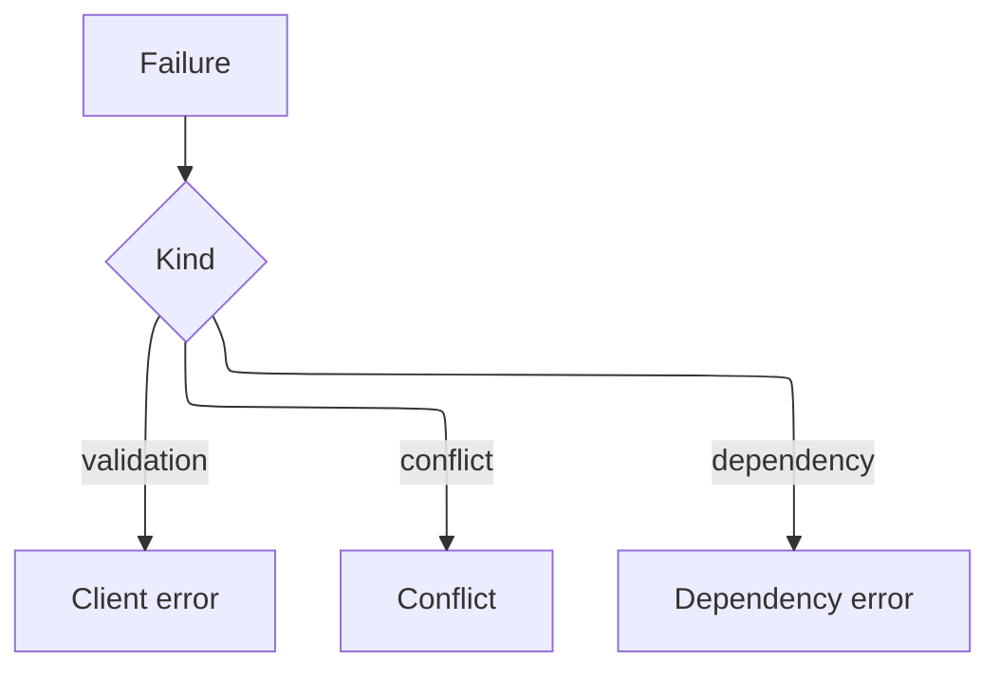

# Design Document

## Overview

[What this feature does, the approach, and why that approach won. Link requirements or bugfix criteria the design covers.]

## Architecture

[Components and the runtime path.]

## Components and Interfaces

### [Component]

[Purpose, responsibilities, non-responsibilities, dependencies.]

## Data Models

## Error Handling

| Condition | Response | State afterward |
| --- | --- | --- |
| [invalid input] | [error] | [unchanged] |

## Testing Strategy

- Unit: [rules and ids]
- Integration: [sequences]
- Property: [invariant]. Validates: Requirement 1.1
