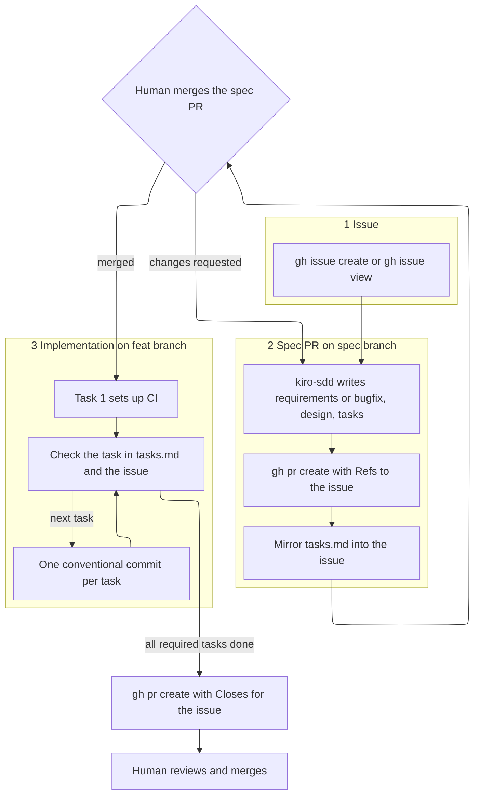

# Kiro GitHub pipeline

Use this skill to carry a Kiro spec from a GitHub issue to an implementation pull request that a human merges. `kiro-sdd` still chooses the workflow and runs the phase gates. `kiro-requirements`, `kiro-design`, `kiro-tasks`, and `kiro-steering` still own the file formats. This skill owns the issue, the branches, the commits, the pull requests, and keeping them in sync. Command recipes are in `references/gh-recipes.md`.

Everything here runs through `git` and `gh`. Any agent that can run shell commands can follow it.

## Pipeline



| Stage | Branch | GitHub object | Link keyword | Moves forward when |
| --- | --- | --- | --- | --- |
| 1 Issue | none | issue `#N`, body from `assets/issue-template.md` | none | the issue exists |
| 2 Spec | `spec/<N>-<slug>` | spec PR, body from `assets/spec-pr-body.md` | `Refs #N` | a human merges it |
| 3 Task sync | spec branch, then feat branch | the agent block in issue `#N`, optionally sub-issues | task numbers | every task commit |
| 4 Implementation | `feat/<N>-<slug>` | one implementation PR, body from `assets/implementation-pr-body.md` | `Closes #N` | a human merges it |

`<N>` is the issue number. `<slug>` is the spec folder name under `.kiro/specs/`. Use the same slug in both branch names. Bugfix specs use the same `feat/` prefix so every spec has one branch shape.

## Before you start

1. `gh auth status` succeeds and `gh repo view --json nameWithOwner` names the repository. If either fails, stop and say which. Do not switch to the web UI on your own.
2. The working tree is clean. Read the default branch name from `gh repo view`. Do not assume `main`.
3. Read `.github/` for an issue template, a pull request template, workflows, and `CONTRIBUTING.md`. Project conventions win over this skill's assets when they conflict. Keep the link keywords and the acceptance checklist either way.

## Stage 1: Issue

- If the user gave an issue number, read it with `gh issue view`. Its body is the idea that `kiro-sdd` starts from. Do not rewrite the human's text. Add only the agent block described in Stage 3.
- Otherwise fill `assets/issue-template.md` into a temporary body file, strip its front matter, and run `gh issue create --title ... --body-file ...`. Add a label only if `gh label list` shows it exists.
- The issue kind picks the workflow. A bug goes to the Bugfix workflow. A feature lets `kiro-sdd` choose Requirements-First or Design-First, and a stated architecture or hard constraint in the issue points to Design-First.
- Copy the template to `.github/ISSUE_TEMPLATE/kiro-spec.md` only when the user asks for it or the repository has no issue template. That copy ships in the spec PR.

## Stage 2: Spec PR, the approval gate

1. Fetch, then create `spec/<N>-<slug>` from the remote default branch.
2. Run `kiro-sdd`. Its phase gates still apply in the conversation unless the user asked for a Quick Spec. Commit each artifact as it is approved, one conventional commit each:
   - `docs(spec): add requirements for <slug>` or `docs(spec): add bugfix analysis for <slug>`
   - `docs(spec): add design for <slug>`
   - `docs(spec): add task plan for <slug>`
   - `docs(steering): <what changed>` for steering files the spec needs
3. Write the agent block into the issue (Stage 3).
4. Push the branch and open the PR against the default branch with `--body-file` from `assets/spec-pr-body.md`. The body says `Refs #N`. Never write `Closes`, `Fixes`, or `Resolves` in a spec PR. GitHub would close the issue when the spec merges.
5. Put the spec PR number in the agent block, then stop. Give the user the PR URL and say that implementation starts after a human merges it. Do not start Stage 4 in the same turn.

Review feedback lands as new commits on the same branch (`docs(spec): revise design for <slug>`). Re-sync the agent block whenever `tasks.md` changes. Do not force-push over commits someone has reviewed unless the human asks.

When you resume, find the spec PR by its head branch and read `state`, `mergedAt`, and `reviewDecision`:

| State | Action |
| --- | --- |
| `MERGED` | Go to Stage 4 |
| `OPEN`, approved | Ask the human to merge. Build on the spec branch only if they explicitly say to, and say so in the implementation PR body |
| `OPEN`, not approved | Address review comments, or wait |
| `CLOSED` without merge | Stop and ask. The spec was rejected |

## Stage 3: Keep the issue in sync with tasks.md

The issue body carries one agent-maintained block between markers. Regenerate the whole block from the spec files at each sync and replace only the text between the markers:

```markdown
<!-- kiro-pipeline:start -->
## Spec

- Folder: `.kiro/specs/reading-queue/`
- Spec PR: #12
- Implementation PR: not opened

## Tasks

- [x] 1. Set up CI for build, lint, and test
- [ ] 2. Define reading-queue types and the SQLite schema
- [ ] 3. Implement queue membership rules
- [ ] 3.1 Append a book to the tail of the member queue
<!-- kiro-pipeline:end -->
```

- One line per checkbox in `tasks.md`, grouping parents included, with the same number, title, order, and checked state. Optional tasks keep `(optional)`.
- `tasks.md` is the source. Change it first, then regenerate the block. Never check an issue line that is unchecked in `tasks.md`.
- Leave every byte outside the markers alone. If the markers are missing, append them at the end of the body.
- Sync when the spec PR opens, after any spec revision that changes `tasks.md`, after each task commit is pushed, and when the implementation PR opens.

### Sub-issues

Use sub-issues when the user asks for them, or when a top-level task is big enough that someone will assign or discuss it separately. Create one sub-issue per top-level task with `gh issue create --parent N`. Title it `<slug> task 3: <task title>`. Its body holds the task's detail bullets and requirement ids.

Record the link in `tasks.md` as a detail bullet `- Sub-issue: #123`, placed before the `_Requirements:_` bullet. The issue checklist line then ends with ` (#123)`. Sub-issues stay open until the implementation PR merges. That PR lists `Closes #123` for each one. When a task's commit is pushed, comment on its sub-issue with the commit SHA. Do not close it by hand.

## Stage 4: Implementation

1. After the spec PR merges, fetch, then create `feat/<N>-<slug>` from the remote default branch.
2. Task 1 is the CI task (`kiro-tasks` puts it first). Start from `assets/ci.yml`. Take build, lint, and test commands from `.kiro/steering/tech.md`, the design, or the project manifest. Do not invent a tool the project does not use. If a command is missing, task 1's detail bullets name the one it adds. If an older `tasks.md` has no CI task, append one with the next free number as `kiro-tasks` describes. Commit that change as `docs(spec): add ci task to <slug> plan` on the feat branch, then run it first.
3. Execute all required leaf tasks continuously in a topological order of the DAG. Tasks in the same parallel group or wave may run in any order after their dependencies are checked. Do not stop for routine review between tasks. For each leaf task, meaning a sub-task or a major task without children:
   1. Implement it. Run the project's build, lint, and test commands locally.
   2. Check its box in `tasks.md` in the same commit. Check a grouping parent in the commit of its last child.
   3. Commit once, using the format below, then push. One conventional commit per task is the normal history.
   4. Sync the issue block from the checked state in `tasks.md`.
   5. Read the CI run for that push. The checked box records locally verified implementation, but the task does not unlock downstream DAG tasks until CI is green. If CI fails, keep working on the same task and make at most three reasonable fix attempts before asking the human. Do not start the next task while CI is red. Do not rewrite pushed history; if a CI-only repair therefore needs an additional commit, keep it scoped to the same task and record the extra commit as a deviation in the implementation PR.
4. Skip optional tasks unless the user asked for them. List skipped optional tasks in the PR body.
5. Open one implementation PR for the spec against the default branch, with `--body-file` from `assets/implementation-pr-body.md`. Its Changes table summarizes every completed task and its Deviations section records every departure from the approved spec or one-commit-per-task history, including "None" when there were no deviations. Then add its number to the issue block.
6. Wait for checks to finish and report the result. Stop. A human reviews and merges.

Step mode is optional. Execute one task and return for review only when the user explicitly asks for one-task-at-a-time execution.

### When to pause during implementation

Pause and ask the human only when:

- a requirement or design ambiguity would materially change the result;
- the approved plan is materially wrong, so `tasks.md`, `design.md`, or the behavior file must change: update the affected spec documents, re-sync the issue, and pause for re-approval before continuing;
- the next action is destructive, irreversible, or outside the approved scope;
- required credentials, secrets, permissions, or service access are missing;
- the same task's tests or CI still fail after three reasonable fix attempts; report the attempts, logs, and remaining failure;
- a step can only be completed by a human.

Do not pause merely because a task ended, checks passed, another task is difficult, or an ordinary implementation decision is needed.

Commit format:

```text
feat(queue): reject duplicate open titles

Task 3.2 of .kiro/specs/reading-queue/tasks.md
Requirements: 1.3, 1.4
Refs #42
```

- Subject: `type(scope): summary`, imperative, lowercase, no trailing period, 72 characters or fewer. Types: `ci` for task 1, then `feat`, `fix`, `test`, `refactor`, `build`, `docs`, `chore` as the work dictates. The scope is the module or area the task touches.
- Body: the task number and spec path, the requirement ids from the task, and `Refs #N`. Commits never say `Closes`. The PR closes the issue.
- Do not add co-author or tool-attribution trailers unless the project's contributing guide asks for them.

### Implementation PR body

- First line `Closes #N`, plus one `Closes #M` line per sub-issue.
- `## Summary`, `## Changes` (one row per completed task with its commit SHA and outcome), `## Deviations` (every departure from the approved spec or normal one-commit-per-task history, or `None`), and `## Testing` (the CI run and the local commands with results).
- `## Acceptance checklist`: one line per acceptance criterion id in `requirements.md` or `bugfix.md`, in document order, quoting the EARS text and naming the test or check that shows it. Check a line only when that evidence is in this PR and passed. Leave a line unchecked with a reason when it is not shown. Skip withdrawn criteria. For a bugfix, the current-behavior lines point at the regression test that failed before the fix.
- Title: a conventional commit subject for the whole change, such as `feat(queue): add reading queue` or `fix(queue): match duplicate titles after case fold`.

After opening, confirm `closingIssuesReferences` on the PR includes `#N`.

## Never

- Merge a pull request, enable auto-merge, or approve your own pull request.
- Push to the default branch.
- Start implementation before the spec PR is merged, unless the human explicitly said to build on the spec branch.
- Put a closing keyword in a spec PR or a commit message.
- Close the parent issue or a sub-issue by hand.
- Force-push over commits a human has reviewed.

## Definition of done

- Issue `#N` links the spec PR and the implementation PR, and its agent block matches `tasks.md` exactly.
- The spec PR says `Refs #N` and was merged by a human.
- Task 1 in `tasks.md` is the CI workflow, and the task DAG starts at it.
- `feat/<N>-<slug>` has one commit per leaf task, plus documented CI repair commits if any, and every required task is checked in `tasks.md` and in the issue.
- The implementation PR is open with `Closes #N`, Summary, Changes covering every completed task, Deviations, Testing, and an acceptance checklist that covers every criterion id that is not withdrawn. CI status is reported, including failures.
