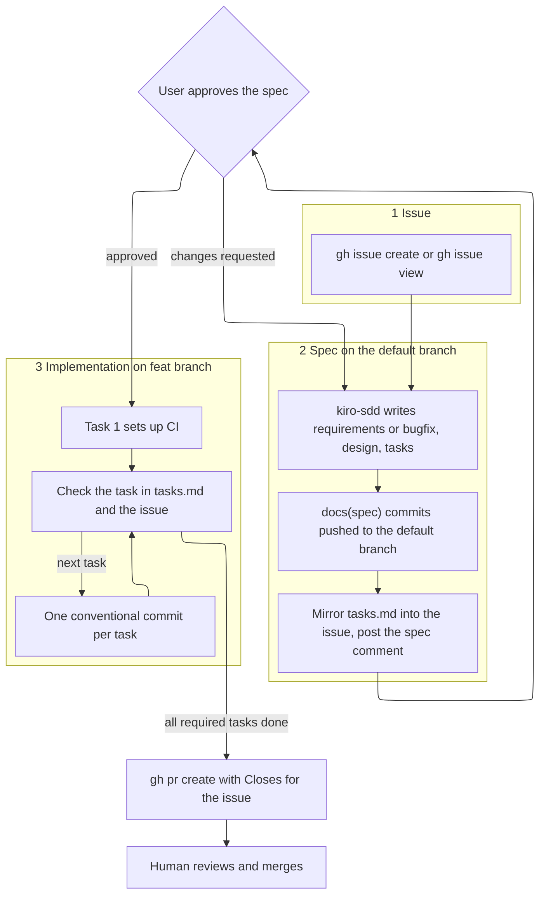

# Kiro GitHub pipeline

Use this skill to carry a Kiro spec from a GitHub issue to an implementation pull request that a human merges. `kiro-sdd` still chooses the workflow, runs the phase gates, and sets the proportion and decision rules. `kiro-requirements`, `kiro-design`, `kiro-tasks`, and `kiro-steering` still own the file formats. This skill owns the issue, the commits, the implementation branch and pull request, and keeping them in sync. Command recipes are in `references/gh-recipes.md`.

Spec documents (`requirements.md` or `bugfix.md`, `design.md`, `tasks.md`) and steering files are not code. They are committed and pushed straight to the default branch: no spec branch, no spec pull request. Pull requests are only for implementation work that may change code.

Everything here runs through `git` and `gh`. Any agent that can run shell commands can follow it.

## Pipeline



| Stage | Where | GitHub object | Link keyword | Moves forward when |
| --- | --- | --- | --- | --- |
| 1 Issue | none | issue `#N`, body from `assets/issue-template.md` | none | the issue exists |
| 2 Spec | default branch, direct commits | one comment on `#N` from `assets/spec-comment.md` | `Refs #N` in each commit | the user approves |
| 3 Task sync | default branch, then feat branch | the agent block in issue `#N`, optionally sub-issues | task numbers | every task commit |
| 4 Implementation | `feat/<N>-<slug>` | one implementation PR, body from `assets/implementation-pr-body.md` | `Closes #N` | a human merges it |

`<N>` is the issue number. `<slug>` is the spec folder name under `.kiro/specs/`. Bugfix specs use the same `feat/` prefix so every implementation has one branch shape.

## Before you start

1. `gh auth status` succeeds and `gh repo view --json nameWithOwner` names the repository. If either fails, stop and say which. Do not switch to the web UI on your own.
2. The working tree is clean. Read the default branch name from `gh repo view`. Do not assume `main`.
3. Read `.github/` for an issue template, a pull request template, workflows, and `CONTRIBUTING.md`. Project conventions win over this skill's assets when they conflict. Keep the link keywords either way.

## Stage 1: Issue

- If the user gave an issue number, read it with `gh issue view`, comments included. Its body is the idea that `kiro-sdd` starts from. Do not rewrite the human's text. Add only the agent block described in Stage 3.
- Otherwise fill `assets/issue-template.md` into a temporary body file, strip its front matter, and run `gh issue create --title ... --body-file ...`. Add a label only if `gh label list` shows it exists.
- The issue kind picks the workflow. A bug goes to the Bugfix workflow. A feature lets `kiro-sdd` choose Requirements-First or Design-First, and a stated architecture or hard constraint in the issue points to Design-First.
- Copy the template to `.github/ISSUE_TEMPLATE/kiro-spec.md` only when the user asks for it or the repository has no issue template. Commit it to the default branch with the spec.

## Stage 2: Spec on the default branch, the approval gate

1. Fetch, switch to the default branch, and fast-forward it to the remote.
2. Run `kiro-sdd`. Its phase gates still apply unless the user asked for a Quick Spec. Commit each artifact and push it to the default branch before asking for its approval, so the user reviews it on GitHub. One conventional commit each, body `Refs #N`:
   - `docs(spec): add requirements for <slug>` or `docs(spec): add bugfix analysis for <slug>`
   - `docs(spec): add design for <slug>`
   - `docs(spec): add task plan for <slug>`
   - `docs(steering): <what changed>` for steering files the spec needs
3. Sync the agent block (Stage 3) with status `awaiting approval`.
4. When the whole spec is on the default branch (after `tasks.md`, or after the single Quick Spec pass), post one comment on `#N` from `assets/spec-comment.md`. Then stop. In chat, give the same short summary (what is being built, the key decisions, anything risky) with the comment URL, and ask for approval. Do not start Stage 4 in the same turn.
5. If the push is rejected, for example by branch protection, stop and tell the user. Do not create a branch or a pull request as a workaround unless they say so.

Open questions go on the issue, never in a commit message or a pull request body. Most should not exist: `kiro-sdd` makes the call and records it in `design.md`. The one or two that survive go under **Questions** in the spec comment, or in their own `gh issue comment` if they come up mid-phase. Repeat them in chat with your recommended answer.

Revisions are more direct commits to the default branch (`docs(spec): revise design for <slug>`). Re-sync the agent block whenever `tasks.md` changes. Never force-push the default branch.

Approval is the user's reply in chat, or a human's approving comment on the issue. Record it by setting the agent block status to `approved`. When you resume, read the status and the issue comments:

| Status | Action |
| --- | --- |
| `awaiting approval` | Read comments since the spec comment. Approval: set `approved` and go to Stage 4. Change requests: revise. Nothing new: remind the user in one line and wait |
| `approved` | Go to Stage 4 |
| `in progress` | Continue Stage 4 from the first unchecked task in DAG order |
| Issue closed without the work | Stop and ask |

## Stage 3: Keep the issue in sync with tasks.md

The issue body carries one agent-maintained block between markers. Regenerate the whole block from the spec files at each sync and replace only the text between the markers:

```markdown
<!-- kiro-pipeline:start -->
## Spec

- Folder: `.kiro/specs/reading-queue/` on `main` at a1b2c3d
- Status: in progress
- Implementation PR: not opened

## Tasks

- [x] 1. Set up CI for build, lint, and test
- [ ] 2. Define reading-queue types and the SQLite schema
- [ ] 3. Implement queue membership rules
- [ ] 3.1 Append a book to the tail of the member queue
<!-- kiro-pipeline:end -->
```

- Status is `awaiting approval`, `approved`, or `in progress`. The commit is the latest spec commit on the default branch.
- One line per checkbox in `tasks.md`, grouping parents included, with the same number, title, order, and checked state. Optional tasks keep `(optional)`.
- `tasks.md` is the source. Change it first, then regenerate the block. Never check an issue line that is unchecked in `tasks.md`.
- Leave every byte outside the markers alone. If the markers are missing, append them at the end of the body.
- Sync when the spec lands on the default branch, after any revision that changes `tasks.md`, after each task commit is pushed, and when the implementation PR opens.

### Sub-issues

Use sub-issues when the user asks for them, or when a top-level task is big enough that someone will assign or discuss it separately. Create one sub-issue per top-level task with `gh issue create --parent N`. Title it `<slug> task 3: <task title>`. Its body holds the task's detail bullets and requirement ids.

Record the link in `tasks.md` as a detail bullet `- Sub-issue: #123`, placed before the `_Requirements:_` bullet. The issue checklist line then ends with ` (#123)`. Sub-issues stay open until the implementation PR merges. That PR lists `Closes #123` for each one. When a task's commit is pushed, comment on its sub-issue with the commit SHA. Do not close it by hand.

## Stage 4: Implementation

1. After approval, fetch, then create `feat/<N>-<slug>` from the remote default branch, which already holds the approved spec. Set the status to `in progress`.
2. Task 1 is the CI task (`kiro-tasks` puts it first). Start from `assets/ci.yml`. Take build, lint, and test commands from `.kiro/steering/tech.md`, the design, or the project manifest. Do not invent a tool the project does not use. If a command is missing, task 1's detail bullets name the one it adds. If an older `tasks.md` has no CI task, append one with the next free number as `kiro-tasks` describes. Commit it to the default branch as `docs(spec): add ci task to <slug> plan` before creating the feat branch, then run it first.
3. Execute all required leaf tasks continuously in a topological order of the DAG. Tasks in the same parallel group or wave may run in any order after their dependencies are checked. Do not stop for routine review between tasks. For each leaf task, meaning a sub-task or a major task without children:
   1. Implement it. Run the project's build, lint, and test commands locally.
   2. Check its box in `tasks.md` in the same commit. Check a grouping parent in the commit of its last child. Checkbox ticks are the only spec edits that travel on the feat branch.
   3. Commit once, using the format below, then push. One conventional commit per task is the normal history.
   4. Sync the issue block from the checked state in `tasks.md`.
   5. Read the CI run for that push. The checked box records locally verified implementation, but the task does not unlock downstream DAG tasks until CI is green. If CI fails, keep working on the same task and make at most three reasonable fix attempts before asking the human. Do not start the next task while CI is red. Do not rewrite pushed history; if a CI-only repair therefore needs an additional commit, keep it scoped to the same task and record it as a deviation in the implementation PR.
4. Skip optional tasks unless the user asked for them. List skipped optional tasks in the PR body.
5. Open one implementation PR for the spec against the default branch, with `--body-file` from `assets/implementation-pr-body.md`. Then add its number to the issue block.
6. Wait for checks to finish and report the result. Stop. A human reviews and merges.

Step mode is optional. Execute one task and return for review only when the user explicitly asks for one-task-at-a-time execution.

### When to pause during implementation

Pause and ask the human only when:

- a requirement or design ambiguity would materially change the result, and the repo, docs, and the user's stated goals do not settle it;
- the approved plan is materially wrong: commit the spec revision to the default branch, merge the default branch into the feat branch, re-sync the issue, and pause for re-approval before continuing;
- the next action is destructive, irreversible, or outside the approved scope;
- required credentials, secrets, permissions, or service access are missing;
- the same task's tests or CI still fail after three reasonable fix attempts; report the attempts, logs, and remaining failure;
- a step can only be completed by a human.

Post the question as a comment on `#N` and repeat it in chat. Do not pause merely because a task ended, checks passed, another task is difficult, or an ordinary implementation decision is needed.

Commit format:

```text
feat(queue): reject duplicate open titles

Task 3.2 of .kiro/specs/reading-queue/tasks.md
Requirements: 1.3, 1.4
Refs #42
```

- Subject: `type(scope): summary`, imperative, lowercase, no trailing period, 72 characters or fewer. Types: `ci` for task 1, then `feat`, `fix`, `test`, `refactor`, `build`, `docs`, `chore` as the work dictates. The scope is the module or area the task touches.
- Body: the task number and spec path, the requirement ids from the task, and `Refs #N`. Commits never say `Closes`. The PR closes the issue.
- Do not add co-author or tool-attribution trailers unless the project's contributing guide asks for them.

### Implementation PR body

- First line `Closes #N`, plus one `Closes #M` line per sub-issue.
- `## Summary`: two or three sentences and the spec path.
- `## Changes`: one row per completed task with its commit SHA and outcome, then one `Deviations:` line (departures from the approved spec or from one commit per task, or `None`) and the optional tasks not done.
- `## Testing`: the CI run and the local commands with results, then one row per requirement mapping its criterion ids to the tests that show them. Name any criterion not shown and why. Skip withdrawn criteria. For a bugfix, the current-behavior row points at the regression test that failed before the fix.
- Nothing else. No open questions, review checklists, or restated spec text.
- Title: a conventional commit subject for the whole change, such as `feat(queue): add reading queue` or `fix(queue): match duplicate titles after case fold`.

After opening, confirm `closingIssuesReferences` on the PR includes `#N`.

## Never

- Merge a pull request, enable auto-merge, or approve your own pull request.
- Push code to the default branch. Only spec and steering documents go there directly.
- Create a spec branch or open a pull request for spec or steering documents.
- Start implementation before the user approves the spec.
- Put a closing keyword in a commit message, or an open question in a pull request body or commit message.
- Close the parent issue or a sub-issue by hand.
- Force-push the default branch, or over commits a human has reviewed.

## Definition of done

- The spec is on the default branch in `docs(spec)` commits that say `Refs #N`, and the user approved it.
- Issue `#N` has the spec comment, any open questions as comments, and an agent block that matches `tasks.md` and links the implementation PR.
- Task 1 in `tasks.md` is the CI workflow, and the task DAG starts at it.
- `feat/<N>-<slug>` has one commit per leaf task, plus documented CI repair commits if any, and every required task is checked in `tasks.md` and in the issue.
- The implementation PR is open with `Closes #N`, Summary, Changes covering every completed task and its deviations, and Testing with CI status (failures included) and criterion coverage.
