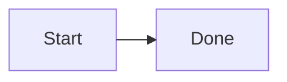
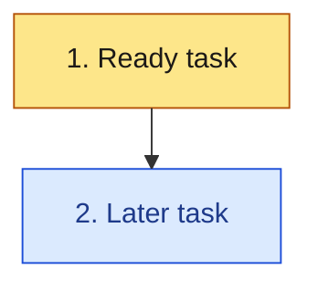

# Mermaid for Kiro docs

Every Markdown file this skill set produces includes Mermaid in fenced blocks that GitHub can render. Syntax notes are in `references/syntax.md`. Official syntax: https://mermaid.js.org/ (flowchart, state, layouts, sequence, class, and ER pages).

## Fence

Put the fence at column 0. The info string is `mermaid` and nothing else.

````markdown

````

Do not indent the fence. Do not use a `mermaid` fence for a sample you know is invalid. Show invalid samples in a `text` fence.

## Layout

Every `flowchart`, `graph`, `stateDiagram`, and `stateDiagram-v2` starts with the YAML front matter in the sample above:

```yaml
---
config:
  layout: elk
---
```

Mermaid documents `config.layout` for flowcharts (including the older `graph` keyword) and for state diagrams, so this one block covers both. The diagram keyword stays after the front matter. The task DAG is a flowchart, including when it uses nested subgraphs, so it gets the same front matter.

If the fence already has front matter, add `layout: elk` under its `config` map. Do not open a second `---` block. If `config.layout` is already `elk`, leave it. Sequence, class, ER, and other diagram types do not get this key. Do not switch a flowchart to the legacy `flowchart-elk` keyword, and do not set `defaultRenderer`.

## Which diagram

| Question the doc answers | Diagram |
| --- | --- |
| Steps, branches, user flow, requirement flow | `flowchart` |
| Who calls whom, in order | `sequenceDiagram` |
| Records and cardinality | `erDiagram` |
| Types and operations | `classDiagram` |
| Lifecycle | `stateDiagram-v2` |
| Task order, phases, parallel groups | `flowchart` with nested subgraphs and `classDef` |

A design doc usually needs the first five. A task doc needs the task DAG from `kiro-tasks`. Steering and ADRs need at least one flowchart.

## Validity rules

Break these and GitHub shows an error instead of a picture.

1. Node ids are bare tokens. Never use a reserved word as an id. In particular never use lowercase `end`. `END` or `finish` is safe. Also avoid `subgraph`, `graph`, `flowchart`, `style`, `classDef`, `class`, `click`, and `direction` as ids.
2. Quote labels that contain parentheses, colons, slashes, commas, question marks, or brackets: `t1["1. Add book"]`.
3. Subgraph ids are single tokens. Titles with spaces go in brackets: `subgraph phase1 [Phase 1 Foundation]`.
4. Close every subgraph, `alt`, `opt`, `loop`, `par`, and `state` block with `end` on its own line.
5. Sequence message text has no raw semicolon. A semicolon starts a new statement. Rephrase, or use `#59;` when you truly need one.
6. Do not use `#` hex colors inside `sequenceDiagram` `box` or `rect` lines. `#` starts a comment. Use `rgb()` there. Hex is fine in flowchart `classDef`.
7. Class names and ER entity names are alphanumeric words. Put spaces in a label, not in the id. Relationship labels with spaces need quotes.
8. Keep diagrams small enough to read. Split a second flowchart rather than drawing twenty nodes in one line. Nested subgraphs are for real groups (a phase that contains a parallel group), not for decoration.
9. Do not use collapsible-subgraph metadata (`@{ view: collapsed }`). It is easy to get wrong and is newer than the diagrams these docs need.
10. After you edit a task list, the DAG node labels must still match the checkbox numbers. The `kiro-tasks` skill owns that check.

## Styling the task DAG

Define classes once, then assign nodes:



`classDef` is the supported styling mechanism. A node takes one class. Put a legend in its own subgraph and do not draw arrows to the legend nodes.

## Validate

From the repo root, when Node.js is available:

```bash
node skills/kiro-mermaid/scripts/validate-mermaid.mjs
```

The script extracts every `mermaid` fence under the paths you pass (default: the repo), writes temporary `.mmd` files, and renders each with `npx @mermaid-js/mermaid-cli` (`mmdc`). It uses Chrome or Chromium when `CHROME_PATH` is set or an executable is on `PATH`. It also rejects a `flowchart`, `graph`, `stateDiagram`, or `stateDiagram-v2` whose front matter does not set `config.layout` to `elk`. Sequence, class, ER, and other types are not checked for that key. Exit 0 means every targeted diagram sets ELK and every block rendered. Exit 1 prints the file, line, and parser message.

`mmdc` validates by rendering. Do not point it at a Markdown file in place. That mode rewrites the file and replaces fences with images. The script renders only temporary copies.

If `mmdc` or a browser is missing, say so. Do not claim the diagrams were validated.
