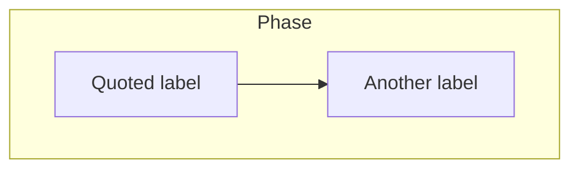
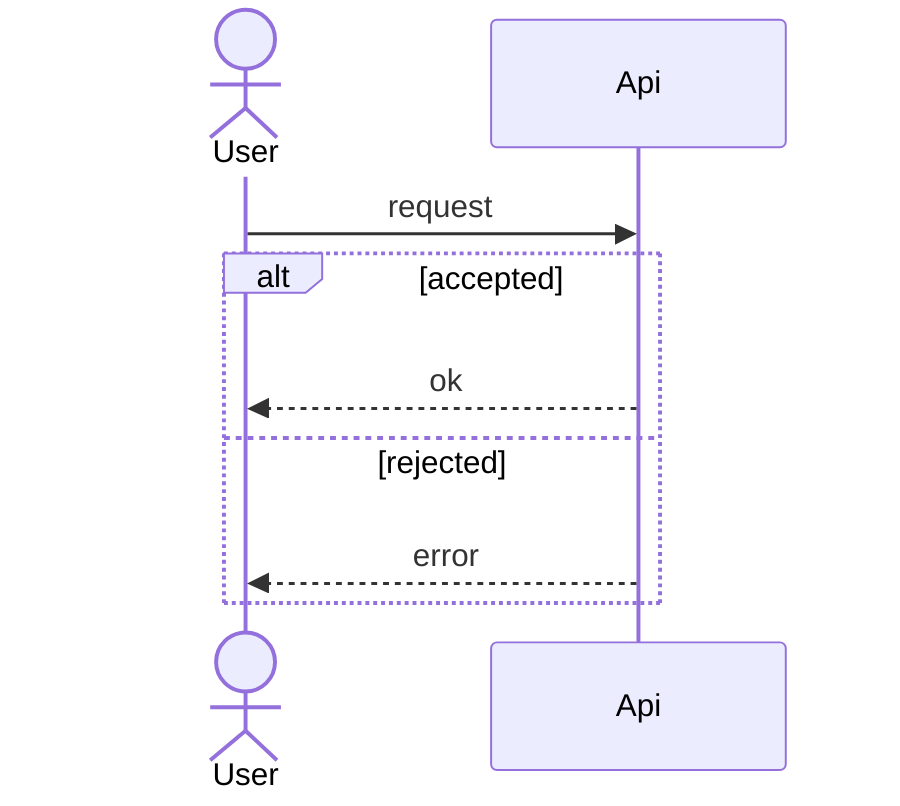
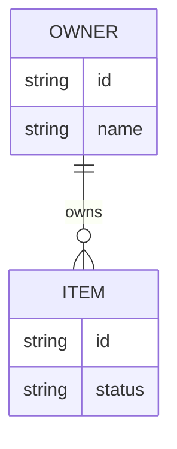
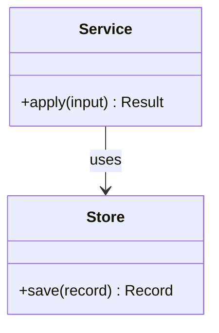
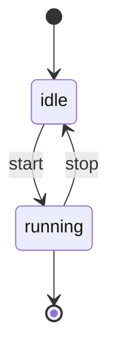

# Mermaid syntax used by these skills

Sources: the flowchart, sequence, class, entity-relationship, and state pages on https://mermaid.js.org/, fetched 2026-10-29. Prefer the forms below. They render on GitHub.

## Flowchart

- First line is `flowchart TB` or `flowchart LR`. `graph` is the older keyword. Use `flowchart`.
- Shapes this set uses: `id["rectangle"]`, `id{"diamond"}`, `id(["stadium"])`.
- Edges: `-->` for depends-on or sequence. Label an edge only when the word is not obvious, and quote the label: `-->|"yes"|`.
- Subgraph direction is ignored when any node inside links outside the subgraph. Set direction on the outer flowchart only.
- `classDef name fill:#fde68a,stroke:#b45309,color:#1c1917` then `class node1,node2 name`.
- Comments are `%%` at the start of a line.

## Sequence

- Declare participants you care about ordering for, before the first message.
- `->>` is a solid arrow. `-->>` is a dotted return.
- `alt` / `else` / `end`, `opt` / `end`, and `loop` / `end` are the control structures these docs use.
- No semicolon in message text.

## ER

Cardinality tokens: `||--||`, `||--o{`, `||--|{`, `}o--o{`. The relationship label is a single token, or a quoted string if you need spaces.

## Class

Class names are letters, digits, underscores, and dashes. Keep method lists short. Avoid commas in a method line if a render fails. Restate the method as `apply(input)`.

## State

State ids are single tokens. Do not name a state `end`.

## Words that break parsers

| Problem | Fix |
| --- | --- |
| Node id `end` | Rename to `finish` or `complete` |
| Label `Add (book)` | `n1["Add (book)"]` |
| Sequence message `a; b` | Two messages, or `a #59; b` |
| `box #ff0000` in a sequence | `box rgb(255, 0, 0)` |
| Subgraph title with spaces and no id | `subgraph id [Phase 1 Foundation]` |
| Unclosed `alt` or subgraph | Add `end` |
