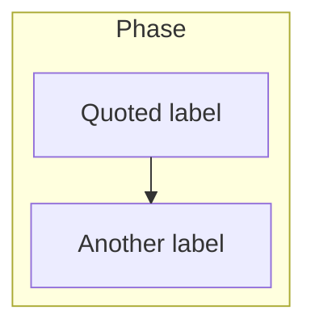
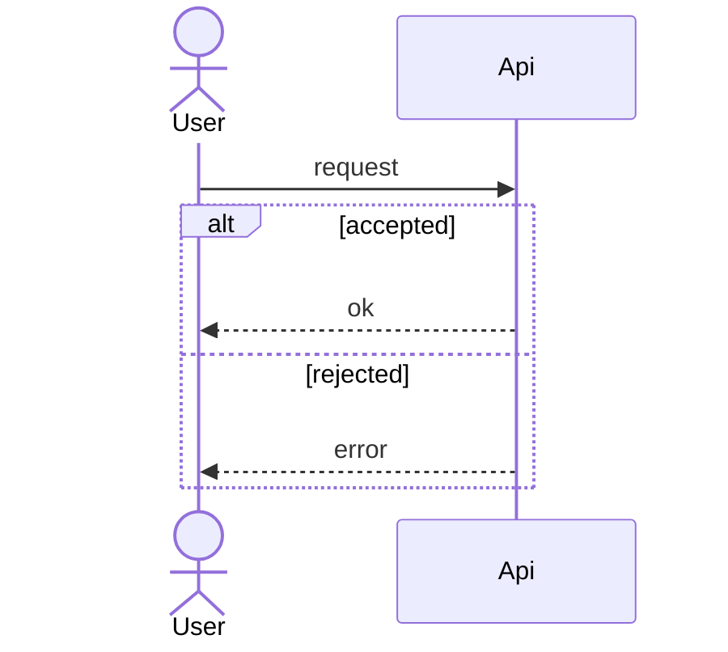
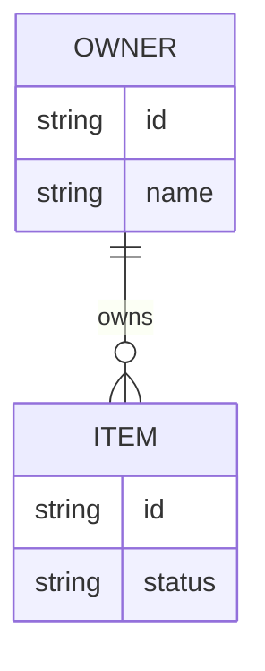
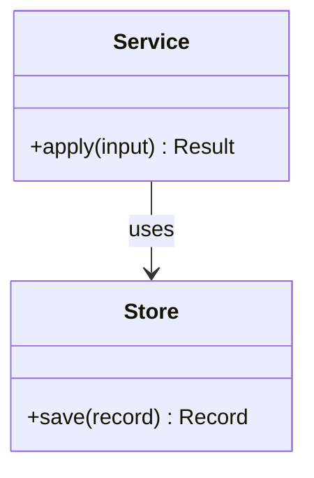
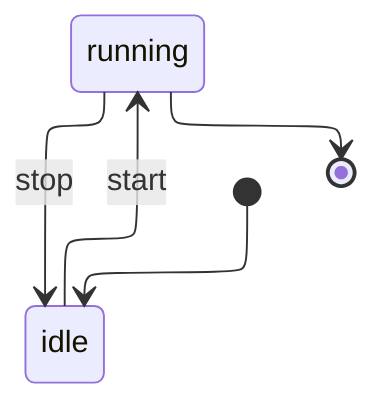

# Mermaid syntax used by these skills

Sources: the flowchart, state, layout, sequence, class, and entity-relationship pages on https://mermaid.js.org/. Layout was checked on 2026-10-31. The other syntax was checked on 2026-10-29. Prefer the forms below. They render on GitHub.

## Layout

Flowcharts and state diagrams select the ELK layout engine in YAML front matter. [Layouts](https://mermaid.js.org/config/layouts.html) documents `config.layout` for `flowchart` and the older `graph` keyword. The state diagram page uses the same key for `stateDiagram-v2`. One block covers `flowchart`, `graph`, `stateDiagram`, and `stateDiagram-v2`:

```yaml
---
config:
  layout: elk
---
```

Put that block first, then the diagram keyword. When the diagram already has front matter, add `layout: elk` under the existing `config` map. Do not open a second `---` block. Leave the key alone when it is already `elk`.

This is the form that applies to both diagram families. The legacy `flowchart-elk` keyword does not cover state diagrams. `defaultRenderer` was removed in Mermaid 12. Do not use either.

Sequence, class, ER, and every other diagram type omit this layout key.

## Flowchart



- Open with the ELK front matter above, then `flowchart TB` or `flowchart LR`. `graph` is the older keyword. Use `flowchart`. Nested subgraphs do not change the front matter.
- Shapes this set uses: `id["rectangle"]`, `id{"diamond"}`, `id(["stadium"])`.
- Edges: `-->` for depends-on or sequence. Label an edge only when the word is not obvious, and quote the label: `-->|"yes"|`.
- Subgraph direction is ignored when any node inside links outside the subgraph. Set direction on the outer flowchart only.
- `classDef name fill:#fde68a,stroke:#b45309,color:#1c1917` then `class node1,node2 name`.
- Comments are `%%` at the start of a line.

## Sequence



- Declare participants you care about ordering for, before the first message.
- `->>` is a solid arrow. `-->>` is a dotted return.
- `alt` / `else` / `end`, `opt` / `end`, and `loop` / `end` are the control structures these docs use.
- No semicolon in message text.

## ER



Cardinality tokens: `||--||`, `||--o{`, `||--|{`, `}o--o{`. The relationship label is a single token, or a quoted string if you need spaces.

## Class



Class names are letters, digits, underscores, and dashes. Keep method lists short. Avoid commas in a method line if a render fails. Restate the method as `apply(input)`.

## State



- Open with the same ELK front matter, then `stateDiagram-v2`. `stateDiagram` is the older keyword. Use `stateDiagram-v2`.
- State ids are single tokens. Do not name a state `end`.

## Words that break parsers

| Problem | Fix |
| --- | --- |
| Node id `end` | Rename to `finish` or `complete` |
| Label `Add (book)` | `n1["Add (book)"]` |
| Sequence message `a; b` | Two messages, or `a #59; b` |
| `box #ff0000` in a sequence | `box rgb(255, 0, 0)` |
| Subgraph title with spaces and no id | `subgraph id [Phase 1 Foundation]` |
| Unclosed `alt` or subgraph | Add `end` |
