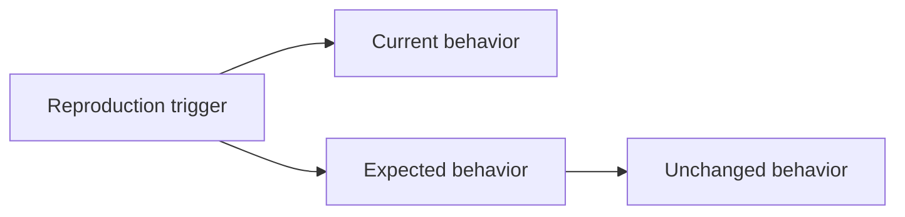
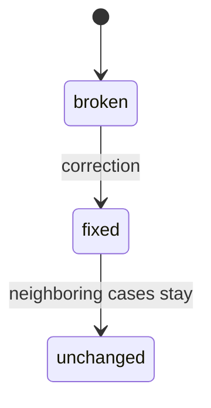

# Bugfix Document

## Introduction

[What breaks, who hits it, and the smallest statement of the fix. List code or behavior that must not be modified.]

## Current Behavior

### Requirement 1

**User Story:** As a [role], I want the defect recorded precisely, so that the fix can prove the bug existed.

#### Acceptance Criteria

1. WHEN [condition] THEN the system [incorrect behavior]

## Expected Behavior

### Requirement 2

**User Story:** As a [role], I want [correct outcome], so that [benefit].

#### Acceptance Criteria

1. WHEN [condition] THEN the system SHALL [correct behavior]

## Unchanged Behavior

### Requirement 3

**User Story:** As a [role], I want surrounding behavior preserved, so that the fix stays surgical.

#### Acceptance Criteria

1. WHEN [condition that already works] THEN the system SHALL CONTINUE TO [existing behavior]
2. WHEN [neighboring case] THEN the system SHALL CONTINUE TO [existing behavior]

