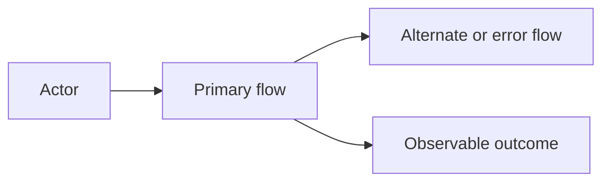
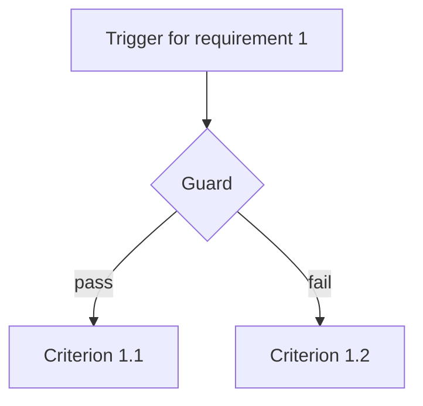

# Requirements Document

## Introduction

[Two or three sentences. Who is affected, what they can do after this feature, and what is explicitly out of scope.]

## Requirements

### Requirement 1

**User Story:** As a [role], I want [capability], so that [benefit].

#### Acceptance Criteria

1. WHEN [event] THEN the system SHALL [observable response]
2. IF [precondition is false] THEN the system SHALL [reject or leave state unchanged]

### Requirement 2

**User Story:** As a [role], I want [capability], so that [benefit].

#### Acceptance Criteria

1. WHEN [event] AND [condition] THEN the system SHALL [response]
2. WHILE [state] THE system SHALL [continuous response]
3. WHERE [context] THE system SHALL [contextual response]
