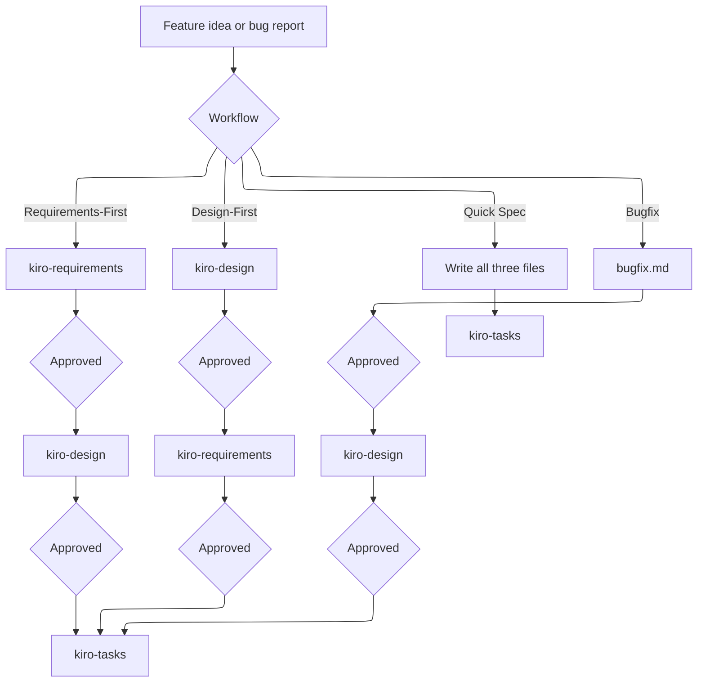

# Kiro spec-driven development

Use this skill to drive a Kiro-compatible spec from idea to an approved task list. Sibling skills own the file formats. Read the matching `SKILL.md` before writing each artifact:

| Phase or artifact | Skill | Output |
| --- | --- | --- |
| Requirements or bug analysis | `kiro-requirements` | `.kiro/specs/<feature>/requirements.md` or `bugfix.md` |
| Design, architecture notes, ADRs | `kiro-design` | `design.md`, plus `docs/` when the spec needs them |
| Implementation plan | `kiro-tasks` | `tasks.md` with a Mermaid task DAG |
| Project context | `kiro-steering` | `.kiro/steering/*.md` |
| Agent hooks | `kiro-hooks` | `.kiro/hooks/*.json` |
| Diagrams in any of the above | `kiro-mermaid` | fenced `mermaid` blocks that parse with `mmdc`; flowcharts and state diagrams set `layout: elk` |
| Issue, branches, and pull requests on GitHub | `kiro-github-pipeline` | issue checklist and spec comment, spec commits on the default branch, `feat/<issue>-<slug>` implementation PR |

When these skills are installed side by side, the sibling folders sit next to this one (`../kiro-requirements/SKILL.md`, and the same for the others).

## GitHub projects

Before the first write, check whether the project uses GitHub: `git remote -v` points at `github.com` or a GitHub Enterprise host the user named, and `gh auth status` succeeds. When both hold, run this skill inside `../kiro-github-pipeline/SKILL.md` and tell the user you are doing so:

- The idea comes from a GitHub issue, or goes into a new one.
- Spec and steering files are not code. Each is committed (`docs(spec): ...`, `docs(steering): ...`, body `Refs #<issue>`) and pushed straight to the default branch. No spec branch, no spec pull request. The phase gates below still apply. The user's approval of the pushed spec is the final gate before any implementation.
- Open questions go on the issue as a comment, never in a pull request or commit message.
- Implementation runs on `feat/<issue>-<slug>` and ends in one implementation pull request that says `Closes #<issue>`. Pull requests are only for this work. A human merges it.

Skip the pipeline only when the user says not to use GitHub for this spec. If the remote is GitHub but `gh` is missing or not authenticated, say so and ask whether to continue with local files only.

## Superpowers

A few steps call [obra/superpowers](https://github.com/obra/superpowers) skills because they do those steps better. `references/superpowers.md` covers which skill runs where, the kiro rules that still apply, the fallbacks, and the scoring behind each choice. Before the first call in a run, if your agent does not already list a skill, run `sh scripts/ensure-superpowers.sh <skill> ...` with every skill the run will need. It installs missing ones (`npx -y skills add obra/superpowers -g -y --skill <skill> ...`) and prints each `SKILL.md` path. If one is `MISSING`, say so in one line, use the fallback, and keep going.

| Step | Superpowers skill |
| --- | --- |
| The idea is too fuzzy to draft | `brainstorming` |
| Bugfix root cause; a failing test, build, or CI run | `systematic-debugging` |
| Each task that changes behavior | `test-driven-development` |
| After the last task, before the implementation PR | `requesting-code-review` |
| Review findings or PR comments | `receiving-code-review` |
| The checkout holds other work when implementation starts | `using-git-worktrees` |

Requirements, design, tasks, the execution loop, verification, and finishing the branch stay with the kiro skills. Do not run `writing-plans`, `executing-plans`, `subagent-driven-development`, or `finishing-a-development-branch` on a Kiro spec, even when another skill hands off to them.

## Choose the workflow first

Pick it from the request with this table. Ask only when the request fits two rows equally. Quick Spec still needs the user to opt in.

If the idea is too fuzzy to draft, meaning the request, issue, and repo leave the user, the outcome, or the scope unclear, run `brainstorming` first. Its outcome feeds the first spec file. A clear idea goes straight to the first draft.

| Workflow | When | Order | Approval gates |
| --- | --- | --- | --- |
| Requirements-First | Behavior is known and the architecture can follow | requirements, design, tasks | Stop after each file |
| Design-First | An architecture, stack, or non-functional constraint comes first | design, requirements, tasks | Stop after each file |
| Quick Spec | The user explicitly wants one pass and trusts the draft | all three, then present them together | Do not stop between phases |
| Bugfix | A defect must be fixed without widening scope | `bugfix.md`, design, tasks | Stop after each file |

Do not switch workflow inside an existing spec folder. A different workflow is a new folder. A bugfix spec is not converted in place into a feature spec; open a separate feature spec when the fix needs new capability.

Feature folder names are kebab-case slugs (`reading-queue`). Create the folder on the first write. Keep the slug stable.

## Proportion and decisions

The spec should be useful, not a burden. Size it to the change and do the thinking yourself.

- **Proportionate.** A small change gets a few requirements and a short design. Group related criteria under one capability instead of one requirement per tool, endpoint, or flag. If the three files pass roughly 500 lines of prose, cut repetition or split the work into smaller specs. Diagrams do not count against this: keep every diagram the sibling skills call for.
- **Say it once.** Requirements own behavior, design owns how and why, tasks own order. Cite ids instead of restating criteria. Prefer a table to paragraphs. No review checklists, sign-off boxes, or ceremony sections.
- **Decide, don't ask.** When a choice has a sensible default (what the repo or a sibling repo already does, steering, the user's stated goal, the smaller scope, deferring a non-goal), make it and record it in `design.md` under Decisions with a one-line rationale. Ask only when a wrong guess would be costly to undo and the repo, sibling repos, docs, and the user's goals cannot settle it. At most one or two crisp questions, each with your recommended answer. Never a questionnaire.
- **Keep momentum.** At each gate, summarize in a few lines: what is being built, the calls you made, and anything risky. Do not paste the file back or make the user re-derive your reasoning.

## Phase gates

Unless the user asked for Quick Spec, do not start the next phase until they approve the current file. Give the short summary above, then ask in the chat:

1. Requirements: "Do the requirements look good? If so, we can move on to the design."
2. Design: "Does the design look good? If so, we can move on to the implementation plan."
3. Tasks: "Do the tasks look good?"

Revise the same file from their feedback and ask again. Treat "yes", "approved", and "looks good" as approval. Anything else is a revision.

On a Requirements-First spec, offer an analysis pass before design. Read `references/workflows.md`. On Quick Spec, still run that checklist silently, fix what it finds, and include residual risks in the summary. Do not pretend a gate happened.

## What to read before writing

1. `.kiro/steering/` if it exists, especially `product.md`, `tech.md`, and `structure.md`.
2. Every file already in `.kiro/specs/<feature>/`.
3. Docs the spec will cite (`docs/architecture.md`, `docs/adr/`).
4. The worked example in this repo at `examples/reading-queue/` when you need a complete specimen. Copy its shape, not its domain, unless the user is working on that example. Its task lists predate the CI-first rule and the single test-and-fix bugfix task in `kiro-tasks`. New task lists follow `kiro-tasks`.

## Definition of done for a spec

- Feature specs contain `requirements.md`, `design.md`, and `tasks.md`. Bugfix specs contain `bugfix.md`, `design.md`, and `tasks.md`.
- Requirement numbers and `_Requirements: 1.2_` task references agree.
- The task DAG in `tasks.md` uses the same numbers as the checkboxes.
- Every Markdown artifact includes Mermaid in fenced `mermaid` blocks, checked with the `kiro-mermaid` skill.
- Tasks are coding tasks only. No deploy, user testing, or metrics gathering tasks.
- Task 1 creates or updates the CI workflow (`.github/workflows/ci.yml` on GitHub), and the task DAG starts at it.
- Steering and hooks are written only when the user asked for them or the spec cannot stay consistent without project context. Do not invent a product steering set for an unrelated repo without being asked.

## Updating an existing spec

Read `references/iteration.md`. Edit files in place. Do not renumber requirements or tasks that are already cited. Append new numbers.

## Executing tasks

Implementation starts only after the requirements or bug analysis, design, and tasks are approved. In the GitHub pipeline, the approved spec must be on the default branch. These are approval gates for the spec documents; there is no routine review gate between implementation tasks.

When the user asks to implement, read all three spec files and execute every required task in one continuous run:

1. Follow the task DAG in topological order. Task 1 is the CI task and runs first. Tasks in the same parallel group or wave may run in any order after all their dependencies are checked.
2. Finish one leaf task before starting the next. Build each task that changes behavior test-first with `test-driven-development`. The approved plan exempts task 1 and config-only tasks, so do not ask. When a test, build, or check fails, use `systematic-debugging`.
3. Check the leaf task in `tasks.md` only when the build, lint, and test output comes from a run made after the task's last change. Check a grouping parent with its last child. Commit the implementation and the checkbox update together as one conventional commit for that task.
4. Continue without stopping for review until every required task is checked. Skip optional tasks unless the user asked for them.
5. Then run `requesting-code-review` once over the whole change, with the three spec files as the requirements. Handle its findings with `receiving-code-review`: fix Critical and Important ones before you report done or open the PR.

Offer step mode, which executes one task and returns for review, only when the user explicitly asks for one-task-at-a-time execution. Do not infer step mode from an ordinary implementation request.

Pause and ask the human only when:

- a requirement or design ambiguity would materially change the result, and the repo, docs, and the user's goals do not settle it;
- the approved plan is materially wrong, so `tasks.md`, `design.md`, or the behavior file must change: update the affected spec documents, keep their diagrams and traceability in sync, and pause for re-approval before continuing implementation;
- the next action is destructive, irreversible, or outside the approved scope;
- required credentials, secrets, permissions, or service access are missing;
- the same task's tests or CI still fail after three fix attempts under `systematic-debugging`; report the attempts and the remaining failure;
- a step can only be completed by a human.

Ordinary implementation choices, successful checks, task boundaries, and tasks that are merely difficult are not reasons to stop.

In the GitHub pipeline, follow `kiro-github-pipeline`: work on `feat/<issue>-<slug>`, push each task commit, and keep `tasks.md` and the issue checklist in sync. Open the single implementation pull request only after all required tasks are complete. Its body is Summary, Changes (every completed task and any deviations), and Testing. Do not merge it.
