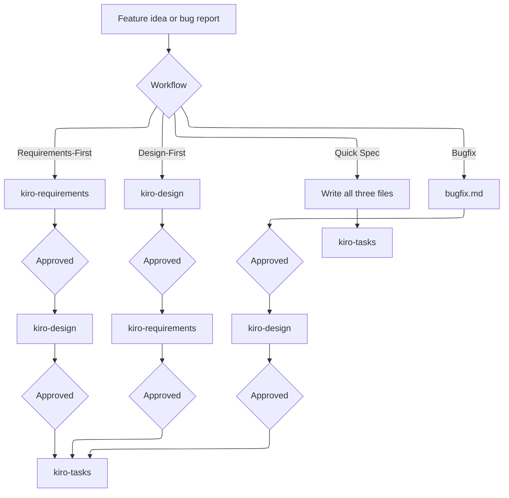

# Kiro spec-driven development

Use this skill to drive a Kiro-compatible spec from idea to an approved task list. Sibling skills own the file formats. Read the matching `SKILL.md` before writing each artifact:

| Phase or artifact | Skill | Output |
| --- | --- | --- |
| Requirements or bug analysis | `kiro-requirements` | `.kiro/specs/<feature>/requirements.md` or `bugfix.md` |
| Design, architecture notes, ADRs | `kiro-design` | `design.md`, plus `docs/` when the spec needs them |
| Implementation plan | `kiro-tasks` | `tasks.md` with a Mermaid task DAG |
| Project context | `kiro-steering` | `.kiro/steering/*.md` |
| Agent hooks | `kiro-hooks` | `.kiro/hooks/*.json` |
| Diagrams in any of the above | `kiro-mermaid` | fenced `mermaid` blocks that parse with `mmdc`; flowcharts and state diagrams set `layout: elk` |

When these skills are installed side by side, the sibling folders sit next to this one (`../kiro-requirements/SKILL.md`, and the same for the others).

## Choose the workflow first

Ask only for what was left open. If the user already named a workflow, do not ask again.

| Workflow | When | Order | Approval gates |
| --- | --- | --- | --- |
| Requirements-First | Behavior is known and the architecture can follow | requirements, design, tasks | Stop after each file |
| Design-First | An architecture, stack, or non-functional constraint comes first | design, requirements, tasks | Stop after each file |
| Quick Spec | The user explicitly wants one pass and trusts the draft | all three, then present them together | Do not stop between phases |
| Bugfix | A defect must be fixed without widening scope | `bugfix.md`, design, tasks | Stop after each file |

Do not switch workflow inside an existing spec folder. A different workflow is a new folder. A bugfix spec is not converted in place into a feature spec; open a separate feature spec when the fix needs new capability.

Feature folder names are kebab-case slugs (`reading-queue`). Create the folder on the first write. Keep the slug stable.

## Phase gates

Unless the user asked for Quick Spec, do not start the next phase until they approve the current file. Ask in the chat, one question at a time:

1. Requirements: "Do the requirements look good? If so, we can move on to the design."
2. Design: "Does the design look good? If so, we can move on to the implementation plan."
3. Tasks: "Do the tasks look good?"

Revise the same file from their feedback and ask again. Treat "yes", "approved", and "looks good" as approval. Anything else is a revision.

On a Requirements-First spec, offer an analysis pass before design. Read `references/workflows.md`. On Quick Spec, still run that checklist silently and list residual risks with the task plan. Do not pretend a gate happened.

## What to read before writing

1. `.kiro/steering/` if it exists, especially `product.md`, `tech.md`, and `structure.md`.
2. Every file already in `.kiro/specs/<feature>/`.
3. Docs the spec will cite (`docs/architecture.md`, `docs/adr/`).
4. The worked example in this repo at `examples/reading-queue/` when you need a complete specimen. Copy its shape, not its domain, unless the user is working on that example.

## Definition of done for a spec

- Feature specs contain `requirements.md`, `design.md`, and `tasks.md`. Bugfix specs contain `bugfix.md`, `design.md`, and `tasks.md`.
- Requirement numbers and `_Requirements: 1.2_` task references agree.
- The task DAG in `tasks.md` uses the same numbers as the checkboxes.
- Every Markdown artifact includes Mermaid in fenced `mermaid` blocks, checked with the `kiro-mermaid` skill.
- Tasks are coding tasks only. No deploy, user testing, or metrics gathering tasks.
- Steering and hooks are written only when the user asked for them or the spec cannot stay consistent without project context. Do not invent a product steering set for an unrelated repo without being asked.

## Updating an existing spec

Read `references/iteration.md`. Edit files in place. Do not renumber requirements or tasks that are already cited. Append new numbers.

## Executing tasks

Executing a task is a separate request. When the user asks to implement, read all three spec files, do one numbered task (its sub-tasks first when it has them), and stop for review. Do not mark a checkbox done unless the work for that task is actually in the tree.
