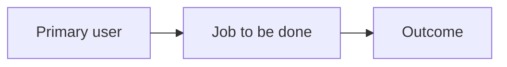

# Product

## Purpose

[What the product is and the job it does.]

## Users

[Who it is for, and who it is not for.]

## Objectives

[The outcomes that should win when a trade-off appears.]

## In scope

- [Capability]

## Out of scope

- [Capability this product will not grow]
