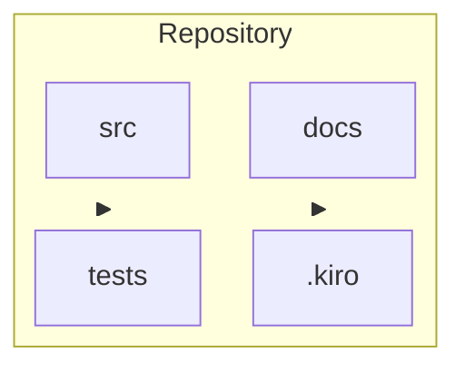

# Project structure

## Layout

[Top-level directories and what belongs in each.]

## Naming and imports

- [File naming]
- [How modules import each other]
- [Where a new feature is allowed to add files]

## Specs and steering

- Specs: `.kiro/specs/<feature-name>/`
- Steering: `.kiro/steering/`
- Hooks: `.kiro/hooks/`
