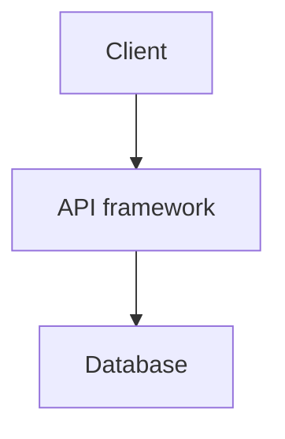

# Technology stack

## Runtime

[Language, framework, and versions that are actually in the repo.]

## Data and integrations

[Database, queues, and external APIs.]

## Constraints

[Latency, compatibility, or library choices that specs must not overturn.]

Live reference:

```text
#[[file:docs/architecture.md]]
```


