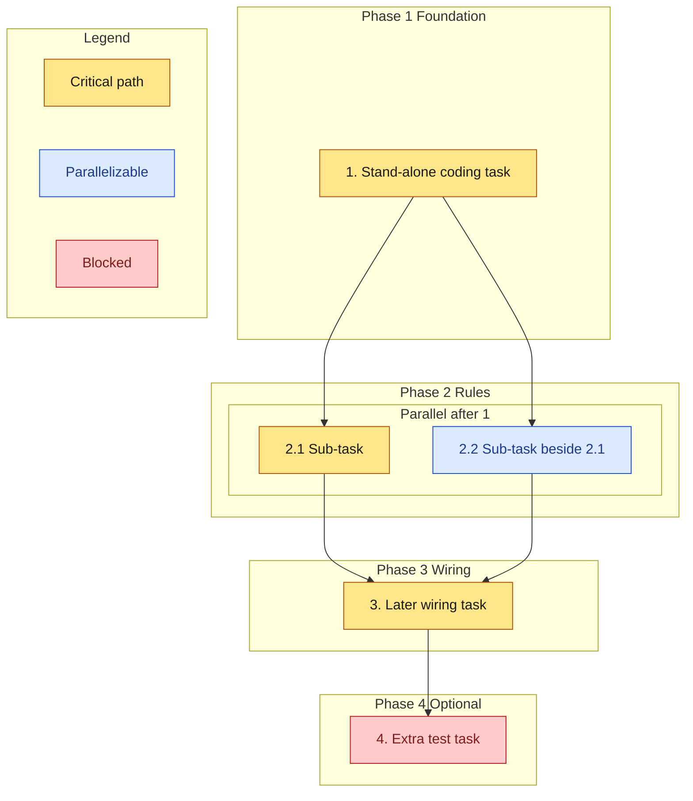

# Implementation Plan

- [ ] 1. [Stand-alone coding task]
  - [What to write or change]
  - _Requirements: 1.1_

- [ ] 2. [Group title]
- [ ] 2.1 [Sub-task]
  - [What to write or change]
  - _Requirements: 1.2, 2.1_
- [ ] 2.2 [Sub-task that can run beside 2.1]
  - [What to write or change]
  - _Requirements: 2.2_

- [ ] 3. [Later wiring task]
  - [Connect the pieces from 2.1 and 2.2]
  - _Requirements: 3.1_

- [ ] 4. [Extra test task] (optional)
  - [Property or characterization tests]
  - _Requirements: 3.1_

## Task graph

Arrows mean depends-on. A task waits until every incoming source is checked.

Primary critical path: 1, 2.1, 3. Task 2.2 is parallel with 2.1. Task 4 is optional, so it is blocked for a required run.
