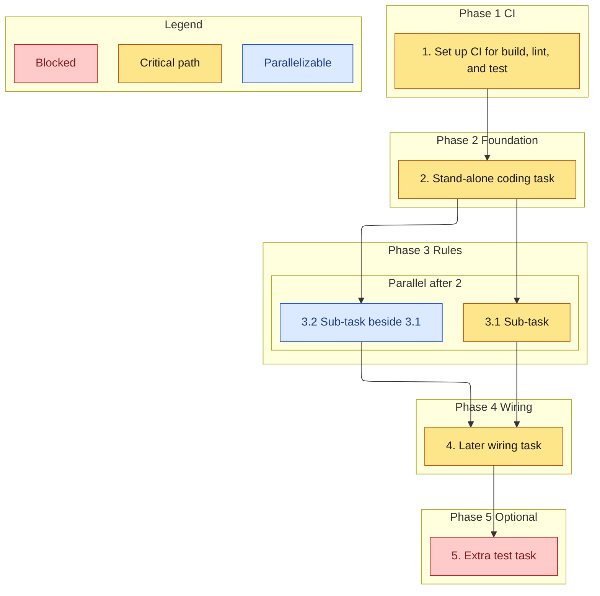

# Implementation Plan

- [ ] 1. Set up CI for build, lint, and test
  - [Create or update `.github/workflows/ci.yml` with the project's build, lint, and test commands]
  - Gates every later task: it must pass before task 2 starts

- [ ] 2. [Stand-alone coding task]
  - [What to write or change]
  - _Requirements: 1.1_

- [ ] 3. [Group title]
- [ ] 3.1 [Sub-task]
  - [What to write or change]
  - _Requirements: 1.2, 2.1_
- [ ] 3.2 [Sub-task that can run beside 3.1]
  - [What to write or change]
  - _Requirements: 2.2_

- [ ] 4. [Later wiring task]
  - [Connect the pieces from 3.1 and 3.2]
  - _Requirements: 3.1_

- [ ] 5. [Extra test task] (optional)
  - [Property or characterization tests]
  - _Requirements: 3.1_

## Task graph

Arrows mean depends-on. A task waits until every incoming source is checked.

Primary critical path: 1, 2, 3.1, 4. Task 1 sets up CI, so every later task lands checked. Task 3.2 is parallel with 3.1. Task 5 is optional, so it is blocked for a required run.
