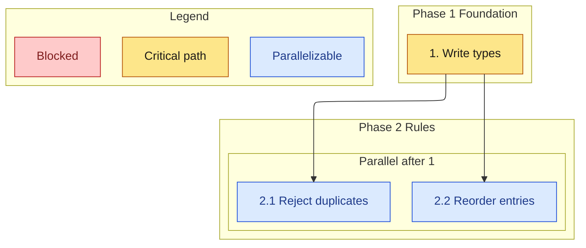

# Task DAG

The diagram lives in `tasks.md` under a `## Task graph` heading, after the checkbox list.

## Structure

- Open with the ELK layout front matter from `kiro-mermaid` (`config.layout: elk`), then `flowchart TB` or `flowchart LR`. Nested subgraphs stay inside that flowchart. Merge into existing front matter instead of adding a second block.
- Direction `TB` or `LR`. Prefer `TB` when there are several phases.
- Subgraph ids are single tokens (`phase1`, `parallel2`, `legend`). Put the human title in brackets: `subgraph phase1 [Phase 1 Foundation]`.
- Nest a parallel group inside its phase.
- Node ids are not the task number. Use `t1`, `t21`, `t22` so a number cannot collide with a reserved word. The visible label carries the official number and the task title, in quotes.
- One arrow `A --> B` means B depends on A.
- Do not link the legend into the graph.
- Style three classes:
  - `critical`: a longest chain of required tasks. If two chains tie, pick the one that delivers the core state change and say so under the diagram.
  - `parallel`: a required task that can run in the same wave as another task once its incoming arrows are satisfied.
  - `blocked`: not part of the required run, or waiting on something outside the spec. Optional tasks are blocked for "run all required".
- A node is in one class. Incoming arrows still mean "not startable until the source is done", including critical nodes that are not the first task.

## Consistency checks

Before approval, all of these are true:

1. Every non-grouping checkbox has exactly one node, and every node (except legend nodes) has exactly one checkbox.
2. The label starts with the checkbox number.
3. Every arrow's source and target exist in the list.
4. There is no cycle.
5. A task that the prose says "builds on X" has an arrow from X.
6. Grouping parents are not nodes, unless the parent itself has a `_Requirements:_` line and no children.
7. Waves implied by the arrows match any wave list you also write. Recompute waves rather than editing them by hand: a task's wave is one more than the max wave of its dependencies. Tasks with no dependencies are wave 1.

Kiro does not read this diagram to discover dependencies. It infers a graph from the task text when running the spec. Keep the task order and the detail bullets consistent with the arrows so that inference and the diagram agree. Early tasks must not depend on later ones.
